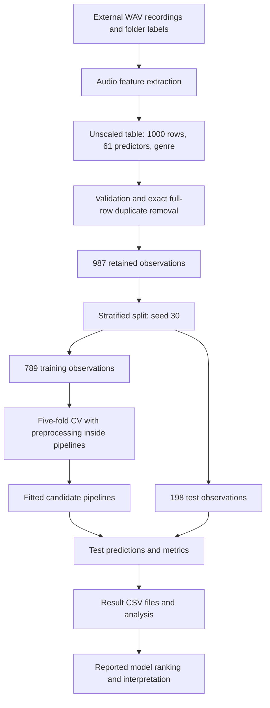

# 3 Dataset, Data Types, and Documentation

## 3.1 Data Sources and Scope

The study uses an audio collection and a numerical representation derived from it to investigate music genre recognition. As established in Chapters 1 and 2, the experimental unit is one recording represented by one feature vector. The source material is a local copy of the GTZAN collection: 1,000 approximately 30-second excerpts, initially divided equally among ten genres. The dataset and its academic attribution are introduced in the preceding chapters; the local collection and extraction workflow are described in the project documentation. The exploratory report `PDF/eda_s27833_2026v2.pdf`, pages 1–3, independently documents this initial collection, its genre labels, and the balanced class distribution before the later cleaning stage.[^ch3-context][^ch3-dataset][^ch3-eda]

The recordings were obtained as an existing collection rather than recorded specifically for this thesis. The original experimental work consists of extracting features, preparing the resulting table, training and comparing classifiers, and analysing their outputs. Publications and other datasets discussed in Chapter 2 provide context; they are not additional training data in the reported experiments.

Table 3.1 distinguishes the data used as model input from the artifacts used to document and interpret the experiments. This distinction matters because an experimental result table, a source recording, and a methodological description have different units of observation and different roles in reproducibility.

**Table 3.1. Data types and their roles in the study.**

| Data type | Documented material and format | Unit and role |
|---|---|---|
| Audio | External GTZAN recordings in `.wav` files | One excerpt; source for feature extraction |
| Tabular input | `data/features_extended.csv` | One recording represented by 61 numerical predictors and one genre label |
| Exploratory tabular data | `data/features_extended_scaled.csv` | Globally standardized features used during exploratory analysis |
| Tabular results | `docs/assignment7_*.csv`, `docs/assignment8_*.csv`, `docs/assignment9_*.csv` | Model variants, classes, search candidates, or features, depending on the file |
| Text and structured metadata | Assignment reports and thesis chapters in Markdown; experiment manifest in JSON | Methodological descriptions, interpretation, and records of experiment execution |
| Visual material | 18 figures embedded in `PDF/eda_s27833_2026v2.pdf`; the explanatory diagram in this chapter | Presentation of distributions, relationships, and processing stages |
| Video | No video dataset documented | Not part of the experimental input or evaluation |

Source: project dataset, preprocessing, organization, and implementation reports, together with the EDA report.[^ch3-dataset][^ch3-organization][^ch3-preprocessing][^ch3-implementation][^ch3-eda]

Audio and tabular data form the empirical basis of the classification task. Text and visual material support documentation and interpretation. There is no separate corpus of lyrics, speech transcripts, photographs, or videos used to fit the models. The following description is based on the recorded research and the preceding thesis chapters; missing acquisition or processing metadata are identified explicitly rather than reconstructed from typical dataset or library defaults.

## 3.2 Storage, Naming, and Preservation

The documented repository separates extracted data, source code, and research reports by their function. Raw audio is kept outside the repository. Its location is supplied through the `AUDIO_DATASET_PATH` environment variable in the consolidated workflow described in Assignment 4. The earlier references to a path in `config.py` describe the previous arrangement.[^ch3-organization]

Listing 3.1 summarizes the documented organization, including the thesis files. The external audio directory serves as the source-data location, while `data/` holds derived feature tables. This implements a logical separation between source and processed data without claiming that directories named `data/raw/` and `data/processed/` already exist.

**Listing 3.1. Organization of the project material described in the research documentation.**

```text
external audio directory/       GTZAN genre folders and WAV recordings

project/
    data/
        features_extended.csv          canonical, unscaled feature table
        features_extended_scaled.csv   exploratory, globally scaled table
    docs/
        assignment*.md                 research reports
        assignment7_*.csv              baseline outputs
        assignment8_*.csv              target-model outputs
        assignment9_*.csv              analysis outputs
        experiment_manifest.json       execution metadata
    PDF/                               exploratory analysis reports
    src/                               extraction, modelling, analysis
    work/
        01.md                          introduction
        02.md                          literature review
        03.md                          dataset and data documentation
    experiment_config.json             shared experimental settings
    requirements.txt                   documented dependency versions
    README.md                          technical project documentation
```

The output names combine a research-stage prefix with the artifact's purpose. For example, `assignment8_learning_curve.csv` identifies both the target-model stage and the type of result. Numerical feature names use lowercase words and underscores, such as `spectral_centroid_mean`; the suffixes `_mean` and `_std` distinguish the statistics. The established filenames are retained so that references in earlier reports remain meaningful.

The unscaled feature table is already a derived dataset: it contains descriptors, not raw waveform samples. The exploratory scaled table is a separate transformation of those descriptors. Duplicate removal and training-specific standardization are further processing stages; the documentation does not establish a separately archived CSV for every intermediate state. Standardized values depend on the particular training partition, so one globally standardized file cannot represent all cross-validation folds correctly.[^ch3-preprocessing]

The preservation rule is to retain source recordings unchanged and write derived material separately. A read-only master copy of the audio would enforce this rule, but filesystem write protection is not established by the supplied research records. Likewise, the existing output names do not demonstrate automatic archival of every historical result. The documented versioning mechanisms are Git and the execution manifest. Assignment 4 also records a temporary-file write procedure and a safeguard against replacing the feature table when extraction yields no records; this is protection against an empty extraction, not a complete version archive.[^ch3-organization]

One root `README.md` provides technical documentation. The dataset descriptions and codebook in this chapter complement it with the meaning, format, and limitations of the data. No separate README for each dataset is documented. For a future standalone data release, those descriptions would need to accompany the corresponding files, together with their version identifiers and applicable source terms.

## 3.3 Audio Data and Genre Labels

### 3.3.1 Collection and Available Metadata

The extractor processes `.wav` recordings from genre folders and produces one row per recording. Assignment 10 states that audio is loaded with `sr=None`, preserving the source sampling rate rather than requesting conversion to a common rate. This documents the loading policy; it does not establish the actual sampling rate, bit depth, or channel count of every local file.[^ch3-implementation]

Table 3.2 records the available audio metadata and the limits of that information. In particular, the approximate excerpt duration is a collection-level description rather than a measured duration catalog.

**Table 3.2. Available metadata for the source audio collection.**

| Metadata item | Documented value or status |
|---|---|
| Collection | Local copy of GTZAN |
| Initial size | 1,000 excerpts; 100 per genre |
| File format | `.wav` |
| Duration | Approximately 30 seconds per excerpt; individual durations not listed |
| Label source | Name of the containing genre folder |
| Sampling-rate policy | Original rate retained during loading with `sr=None` |
| Actual rates, bit depths, and channel counts | Not cataloged in the supplied research records |
| Exact download source, acquisition date, and collection version | Not recorded sufficiently to identify the local copy |
| Original microphone, recording environment, and recording dates | Not specified for individual source files |
| Persistent recording identifiers and artist metadata in the feature table | Not provided by the documented 62-column schema |
| Redistribution terms for the local audio copy | No authorizing license included in the documented project material |

Source: Assignments 3 and 10, with the provenance limitations identified in Chapter 2.[^ch3-dataset][^ch3-implementation][^ch3-context]

The missing acquisition information limits reconstruction of the audio-to-feature stage. Section 5.12 of the EDA report discusses heterogeneous recording conditions as a general dataset limitation, but does not supply acquisition metadata for individual local files.[^ch3-eda] A file-level catalog containing a stable recording identifier, relative source path, genre, duration in seconds, sampling rate in hertz, channel count, encoding information, and file hash would improve traceability. Such a catalog is a documentation improvement, not an artifact claimed to have been produced during the completed experiments. The manifest timestamps discussed in Section 3.5 identify computational runs and must not be interpreted as recording or download dates.

### 3.3.2 Audio Processing and Labels

The documented transformation is feature extraction using `librosa`. Tempo is represented by one estimate, while the other descriptor groups are aggregated across frames using means and standard deviations. This converts a waveform into a compact numerical record suitable for classical classifiers. It also removes the temporal ordering of descriptor values, so the table does not preserve a complete sequence of musical events.[^ch3-preprocessing]

The records do not document a separate denoising, silence-trimming, loudness-normalization, or audio-augmentation procedure. No fixed analysis sampling rate or recording bit depth is therefore asserted here. Window length, hop length, spectral rolloff threshold, and detailed MFCC and chroma settings are also not enumerated in the supplied reports. Library and source-code versions help identify the implementation, but do not replace an explicit parameter record for an independently specified extractor.

The target `genre` is a nominal categorical variable with ten allowed values: `blues`, `classical`, `country`, `disco`, `hiphop`, `jazz`, `metal`, `pop`, `reggae`, and `rock`. These labels come from the source directory structure. They do not represent a numerical ordering. No new manual annotation campaign, annotation guidelines, number of annotators, or inter-annotator agreement measurement is documented. Accordingly, the study evaluates prediction of the supplied labels rather than agreement with a newly established annotation standard.

The audio is music rather than a speech-transcription dataset. No speech transcripts or speaker labels are needed for the reported classification workflow, and none are presented as experimental products. The research also does not supply a numbered set of audio examples for distribution with the thesis.

## 3.4 Tabular Data

### 3.4.1 Observation Structure and Data Quality

The canonical feature table has one observation per recording, 61 numerical predictor columns, and one target column. Its machine-readable format is CSV. Column names identify the variables directly; colors, fonts, or merged cells are not part of the feature representation. The documented schema has no recording-ID or artist-ID column. A row position therefore cannot substitute for a persistent identifier when connecting a cleaned table back to individual source files.[^ch3-preprocessing][^ch3-context]

The initial table contains 1,000 rows. The EDA report's Figure 1 on page 2 shows 100 observations in each of the ten classes. Removing 13 exact duplicate full rows before splitting later leaves 987 observations. The PDF discusses the risk of duplicate recordings but does not report this removal count or the resulting 987-row dataset. The two dataset sizes therefore describe successive stages, not conflicting counts for one stage. The resulting class distribution and test-set support are shown in Table 3.3. The cleaned counts come from Assignment 10; test counts come from the saved target-model classification report. The removed counts are calculated as 100 minus the retained count.[^ch3-eda][^ch3-implementation][^ch3-class-report]

**Table 3.3. Class counts before cleaning, after cleaning, and in the common test partition.**

| Genre | Initial observations | Duplicate rows removed | Retained observations | Test observations |
|---|---:|---:|---:|---:|
| blues | 100 | 0 | 100 | 20 |
| classical | 100 | 0 | 100 | 20 |
| country | 100 | 0 | 100 | 20 |
| disco | 100 | 1 | 99 | 20 |
| hiphop | 100 | 2 | 98 | 20 |
| jazz | 100 | 0 | 100 | 20 |
| metal | 100 | 7 | 93 | 18 |
| pop | 100 | 2 | 98 | 20 |
| reggae | 100 | 1 | 99 | 20 |
| rock | 100 | 0 | 100 | 20 |
| **Total** | **1,000** | **13** | **987** | **198** |

Table 3.3 shows that cleaning affects the classes unevenly: `metal` loses seven rows, while five genres retain all 100 observations. The dataset remains approximately balanced, but no longer has identical class sizes. Duplicate-row removal does not establish that 13 duplicate audio files were identified, and it does not remove all possible near-duplicates or artist overlap. These limits are consistent with the discussion in Section 2.5.1.

The EDA report explicitly records no missing values and successful processing of all audio files on page 2. Assignment 6 additionally reports no constant predictor columns; the PDF does not document that particular check. The documented modelling loader rejects missing values, and no imputation was needed for these experiments. Proposed future median imputation in the preprocessing report is not treated as a completed step. No sentinel value such as `-1` or `-999` is defined as missing data; in particular, negative MFCC values must not be reinterpreted as missing observations.[^ch3-eda][^ch3-preprocessing]

The codebook below states semantic validity conditions, not empirical ranges measured from the full feature table. It does not imply that every condition was implemented as a separate validator. Numerical values should be finite, and labels should match the controlled set. The MFCC and chroma boxplots on pages 9–10 of the EDA report display observations beyond their whiskers, but the report does not specify an outlier-removal rule or a count of excluded observations. No additional removal of outliers, conflicting labels, or invalid audio files is therefore asserted without a documented exclusion record.[^ch3-eda]

### 3.4.2 Feature Data Dictionary

Table 3.4 defines the complete input schema using indexed entries for the MFCC and chroma families. For MFCC fields, `i` takes each integer from 1 through 13; for chroma fields, `j` takes each integer from 1 through 12. Thus, `mfcc_i_mean` explicitly covers `mfcc_1_mean` through `mfcc_13_mean`, and the same expansion applies to the other indexed entries. These names and index ranges are confirmed by the 61 feature names in the saved permutation-importance table.[^ch3-importance]

The suffix `_mean` denotes a mean across frames of one recording, and `_std` denotes the corresponding standard deviation. These statistics describe within-recording variation, not variability between cross-validation folds. The type `float` describes the intended numerical interpretation of a CSV field; CSV itself does not enforce a physical storage type.

**Table 3.4. Codebook for the 61 numerical predictors and the target label.**

| Field or indexed fields | Number | Type | Meaning and unit or scale | Semantic constraints |
|---|---:|---|---|---|
| `tempo` | 1 | float | Estimated rhythmic speed, beats per minute (BPM) | Finite, non-negative; no empirical acceptance interval documented |
| `zcr_mean` | 1 | float | Mean zero-crossing rate; dimensionless proportion | Between 0 and 1 |
| `zcr_std` | 1 | float | Standard deviation of zero-crossing rate; dimensionless | Finite, non-negative |
| `rms_mean` | 1 | float | Mean root-mean-square waveform amplitude; digital signal scale | Finite, non-negative; not calibrated sound pressure or dB |
| `rms_std` | 1 | float | Standard deviation of RMS amplitude; same signal scale | Finite, non-negative |
| `spectral_centroid_mean` | 1 | float | Mean spectral centre of mass; frequency in Hz | Finite, non-negative |
| `spectral_centroid_std` | 1 | float | Standard deviation of spectral centroid; Hz | Finite, non-negative |
| `spectral_bandwidth_mean` | 1 | float | Mean spectral spread; frequency in Hz | Finite, non-negative |
| `spectral_bandwidth_std` | 1 | float | Standard deviation of spectral bandwidth; Hz | Finite, non-negative |
| `spectral_rolloff_mean` | 1 | float | Mean frequency below which the configured fraction of spectral energy lies; Hz | Finite, non-negative; energy threshold not specified in reports |
| `spectral_rolloff_std` | 1 | float | Standard deviation of spectral rolloff frequency; Hz | Finite, non-negative |
| `mfcc_i_mean`, `i = 1, ..., 13` | 13 | float | Mean of each stored MFCC component; coefficient scale without a physical unit | Finite; signed values allowed |
| `mfcc_i_std`, `i = 1, ..., 13` | 13 | float | Standard deviation of each stored MFCC component; coefficient scale | Finite, non-negative |
| `chroma_j_mean`, `j = 1, ..., 12` | 12 | float | Mean of each stored chroma component; dimensionless pitch-class representation | Finite, non-negative; normalization bounds not specified in reports |
| `chroma_j_std`, `j = 1, ..., 12` | 12 | float | Standard deviation of each stored chroma component; dimensionless | Finite, non-negative |
| `genre` | 1 | categorical text | Target genre inherited from the source folder | One of the ten labels listed in Section 3.3.2 |

Source: feature definitions in Assignments 6 and 10 and field names in the permutation-importance CSV, checked against the feature groups on page 2 and plot labels on pages 3–10 of the EDA report.[^ch3-preprocessing][^ch3-implementation][^ch3-importance][^ch3-eda] Units and constraints describe the named descriptors; no observed minimum or maximum is inferred from them.

The numerical count is `1 + 2 + 2 + 2 + 2 + 2 + 26 + 24 = 61`. Adding `genre` gives the documented total of 62 columns. The indexed names retain the stored numbering; the reports do not establish a mapping from chroma indices to named notes or from MFCC field numbers to a separate mathematical indexing convention. Those mappings are therefore not invented here.

Table 3.4 also explains the need for scale-aware modelling. Tempo, spectral frequencies, and coefficient values occupy different numerical scales. `StandardScaler` transforms a feature using the mean and standard deviation learned from the relevant training data. The transformed values are dimensionless and may be negative even when the original descriptor is non-negative. The original-unit constraints therefore apply to the unscaled table, not to standardized model inputs.

### 3.4.3 Experimental Result Tables

The saved result tables have different units of observation from the feature table. For example, one row may describe a classifier configuration, a genre, or a predictor's permutation importance. They must not be joined by row position or interpreted as additional recordings. Table 3.5 provides a compact catalog of these artifacts and their main field conventions.[^ch3-results]

**Table 3.5. Catalog and interpretation of the experimental CSV outputs.**

| Output group in `docs/` | Row meaning and size in the supplied outputs | Field interpretation |
|---|---|---|
| `assignment7_baseline_results.csv`; `assignment8_target_results.csv`; `assignment8_comparative_results.csv`; `assignment9_consolidated_results.csv` | Respectively 9 baseline variants, 2 SVM variants, 2 compared models, and 11 consolidated variants | Model and variant identifiers are text; accuracy and macro metrics are dimensionless scores; timing fields are in seconds |
| `assignment8_optimization_results.csv`; `assignment9_hyperparameter_stability.csv` | 150 search-result rows and 15 stability-summary rows | Hyperparameter configurations and cross-validation statistics; rows are not independent audio observations |
| `assignment8_learning_curve.csv` | 5 training-size settings | `train_size` counts observations fitted within a cross-validation fold; score means and standard deviations summarize cross-validation behaviour |
| `assignment7_classification_reports.csv`; `assignment8_classification_report.csv` | 117 model/report rows and 13 report rows, respectively | Class precision, recall, F1, and support, together with aggregate report entries |
| `assignment7_best_confusion_matrix.csv`; `assignment8_best_confusion_matrix.csv` | Each contains a 10 by 10 matrix | Row labels identify true classes, columns predicted classes; cells are counts |
| `assignment9_error_summary.csv`; `assignment9_misclassification_pairs.csv` | 10 class summaries and 38 observed error pairs | Counts and rates of errors; a class-pair row is an aggregate, not a track identifier |
| `assignment9_permutation_importance.csv` | 61 predictors | `feature` is text; `importance_mean` is mean accuracy decrease; `importance_std` is its variation across permutations |

Several export details require explicit interpretation. The confusion matrices and classification reports have an unnamed first CSV column containing row labels. It is an exported index, not an unnamed audio measurement or a missing observation. Readers should retain it as a class or report-entry identifier. A normalized export could name this field explicitly, but the existing research files are described here in their saved form.

Classification reports mix class-level and aggregate entries. For the target-model report, the ten class rows have supports summing to 198. The `accuracy` row repeats the scalar accuracy value across the exported metric columns, including `support`; that particular cell is not a sample count. The `macro avg` and `weighted avg` rows are summaries, so summing support over all report rows would count observations repeatedly.[^ch3-class-report]

Accuracy, precision, recall, and F1 are stored as proportions between 0 and 1. Percentages in thesis prose must be obtained by multiplying those values by 100. A difference of 0.02 corresponds to two percentage points, not automatically a two-percent relative improvement. Permutation importance has a different interpretation: a negative mean decrease is possible when shuffling a feature improves the measured score, and is not a missing-value code. Parameter columns such as `params` or `best_params` contain textual Python-dictionary representations rather than JSON objects.

In the learning-curve table, the recorded training sizes are 126, 252, 378, 504, and 631. These refer to fitting within cross-validation folds, rather than to the full training partition of 789 observations. Cross-validation score fields ending in `_std` represent standard deviations across folds, not confidence intervals. The fields `generalization_gap` and `train_validation_gap` record mean training accuracy minus mean validation accuracy. `rank_validation_accuracy` is a positive integer indicating validation ranking, with ties permitted.

The full machine-readable tables remain supplementary research artifacts. The main thesis uses compact summaries and selected examples with numbered captions and textual interpretation, as in Table 3.3. Detailed performance comparisons belong in Chapter 7; the role of this chapter is to establish what the stored values mean.

## 3.5 Text Data and Structured Metadata

The text material consists of Markdown reports, thesis prose, documented Python scripts, and JSON configuration and execution records. These are records of the research process, not a natural-language classification corpus. Their meaningful units are a document or section, a source file, a configuration object, and an execution record. Lowercasing, punctuation removal, tokenization, stopword removal, and linguistic annotation were not part of the reported data preparation. Applying such transformations to code, filenames, or configuration keys could change their meaning.

The consolidated configuration is described in Assignment 4 as holding the random seed, test fraction, cross-validation settings, dataset and output paths, model search spaces, and analysis parameters. The actual execution metadata are stored in `docs/experiment_manifest.json`, whose top-level `runs` array contains ten records dated 15 June 2026. Table 3.6 defines the fields needed to interpret those records.[^ch3-organization][^ch3-manifest]

**Table 3.6. Data dictionary for the experiment manifest.**

| Field | Type and format | Meaning |
|---|---|---|
| `runs` | array of objects | Ordered collection of saved execution records |
| `stage` | categorical text | Recorded stage: `baseline_models`, `target_model`, or `results_analysis` |
| `timestamp_utc` | ISO 8601 datetime string with UTC offset | Time of the computational run |
| `git_commit` | hexadecimal string | Repository revision reported at execution |
| `dirty_worktree` | boolean | Whether uncommitted changes were present |
| `config_path` | path string | Configuration location in the recorded environment |
| `config_sha256` | 64-character hexadecimal string | SHA-256 fingerprint of configuration bytes |
| `feature_file_sha256` | 64-character hexadecimal string | SHA-256 fingerprint of the canonical feature-table bytes |
| `python` | version string | Python version used for the run |
| `platform` | text | Recorded operating-system information |
| `packages` | object mapping names to version strings | Recorded versions of the principal libraries |
| `source_sha256` | object mapping source paths to hashes | SHA-256 fingerprints of the tracked source files |

The manifest records Python 3.14.0, `librosa` 0.11.0, NumPy 2.3.5, pandas 2.3.3, and scikit-learn 1.8.0 for these runs. Assignment 4 additionally documents Matplotlib 3.10.8 and seaborn 0.13.2 as plotting dependencies. These values describe the recorded research environment, not a new verification of the currently installed environment.

As Table 3.6 shows, hashes identify exact file contents, while timestamps place executions in order. All ten manifest records have `dirty_worktree=true`. Consequently, a commit identifier alone is insufficient to reconstruct the executed source state. Source hashes can verify a recovered file, but cannot recover missing file contents. Reproduction requires the matching source, configuration, and input files as well as their fingerprints.

Short code or text excerpts in the thesis should retain their source and purpose. A quotation from a report is evidence of what was documented; it is not an additional measurement. The present chapter paraphrases the local reports and links them in its documentation references. Listing 3.1 is a descriptive layout, not a claim that new data directories were created.

## 3.6 Images, Diagrams, and Video

Visual material in this project supports explanation of numerical data and workflow. The 13-page EDA report contains 18 numbered figures: a class-count bar chart on page 2; histograms with distribution curves for tempo, RMS, spectral descriptors, and zero-crossing rate on pages 3–8; MFCC and chroma boxplots on pages 9–10; a correlation heatmap for 11 global descriptors on page 11; and a two-dimensional PCA projection of MFCC and chroma features on page 12. These embedded figures document the exploratory analysis directly. A separate catalog of original plot files, export settings, and image-editing history is not supplied. No photographic or scanned-image dataset is described as model input.[^ch3-eda]

Two inconsistencies in the PDF require care when interpreting its figures. On page 9, the captions for Figures 13 and 14 are reversed relative to the plotted variables: Figure 13 contains `mfcc_1_std` through `mfcc_13_std`, while Figure 14 contains the corresponding `_mean` fields. The codebook in Table 3.4 follows the variable names and statistics shown inside the plots. On page 11, the prose describes spectral correlations as moderate, whereas Figure 17 displays correlations of approximately 0.98 between `spectral_centroid_mean` and `spectral_rolloff_mean`, 0.95 between `spectral_bandwidth_mean` and `spectral_rolloff_mean`, and 0.90 between `spectral_centroid_mean` and `spectral_bandwidth_mean`. These rounded values indicate strong pairwise relationships, consistent with the redundancy discussed in Assignment 6. The PDF's blanket statement that no extreme multicollinearity was observed is therefore not adopted as evidence of feature independence.[^ch3-eda][^ch3-preprocessing]

The PCA figure shows partial grouping and substantial overlap of genre labels in a projection of the MFCC and chroma representation. It is not a projection explicitly documented as using all 61 predictors. Overlap in two dimensions does not establish the absence of linear separability in the original feature space or demonstrate that SVM must outperform a linear classifier. The plot motivates empirical model comparison; the later experiments provide the performance evidence. The PDF does not report the explained-variance ratios or a complete configuration for reproducing this projection.[^ch3-eda]

Figure 3.1 illustrates the documented relationship between source recordings, feature extraction, modelling, and reporting. It is an explanatory diagram constructed from the research records, not a newly measured experimental result.



**Figure 3.1. Data flow from the external audio collection to the reported experimental artifacts.** Source: synthesis of the local dataset, preprocessing, and organization reports, with the evaluation qualification retained from Section 2.5.2.[^ch3-dataset][^ch3-preprocessing][^ch3-organization][^ch3-context]

Figure 3.1 emphasizes that the test data are withheld from fitting preprocessing and classifier parameters. However, as documented in Chapters 1 and 2, test-score ranking influences identification of the best reported model variants. The partition is therefore held out from fitting, but is not independent of every selection decision. Calling it an entirely untouched final confirmation set would overstate the experimental design.

When numerical outputs are presented as figures in subsequent chapters, their captions need to identify the source table, plotted quantity, units, and relevant aggregation. A confusion-matrix figure, for example, must state whether its cells show counts or normalized proportions. PCA figures describe the exploratory projection and must not be presented as evidence that PCA was used in the final classifier. Each figure must also have a textual reference explaining the pattern relevant to the argument.

For thesis export, diagrams and line plots are suitable for vector PDF or SVG; raster versions should use lossless PNG and sufficient resolution at the intended print size, typically 300 dpi. Axis labels and legends must remain legible after resizing. These are presentation requirements for the manuscript, not verified properties of the earlier plot exports. Regenerating a plot from its documented numerical source is preferable to altering image pixels, and any changes to scales, normalization, or displayed subsets must be stated.

No video recordings, simulation videos, video frame catalog, or video-based measurements are documented. Video preparation, frame-rate standardization, key-frame extraction, and video supplements are therefore outside the completed study. They are not introduced solely to populate an unused data category.

## 3.7 Provenance, Rights, and Privacy

The provenance of the source collection is relevant both to attribution and to reproducibility. GTZAN is identified in the project records and attributed in Chapters 1 and 2, but the exact download source and version of the local copy remain insufficiently documented. Assignment 3 explicitly states that the repository does not include a license authorizing redistribution of that audio. Keeping the source audio outside the repository avoids including it in the distributed project files; it does not by itself establish permission to redistribute it elsewhere.[^ch3-dataset]

Before any release that includes source recordings or audio examples, the applicable terms for the actual copy would need to be recorded and assessed. This chapter does not assign a license to the collection or infer that a license discussed for another dataset applies to it. The same distinction applies to derived feature tables: their inclusion in the project is documented, but it is not evidence of unrestricted reuse rights.

The described feature table contains numerical descriptors and genre labels, with no names, addresses, speaker IDs, or participant questionnaires. This describes its schema, not a verified anonymization process for the original recordings. No new recording of research participants, consent procedure, or ethics approval is documented. Local filesystem paths in the manifest identify the execution environment; a public export should review them for unnecessary personal or machine-specific details while preserving the information needed to reproduce the experiment. No additional university-specific approval or retention policy is asserted without a supplied requirement.

## 3.8 Reproducibility and Documentation Boundaries

Two levels of reproduction must be distinguished. Repeating model evaluation from the canonical feature table requires the matching table, configuration, source files, and software environment. Regenerating that table from audio additionally requires the same source collection and sufficiently detailed extraction settings. The existing documentation is stronger for the first level because the manifest fingerprints the feature table but does not provide an inventory and hashes of the original audio files. It also does not contain hashes of the result CSV files, so it does not independently establish which recorded execution produced each current output.[^ch3-organization][^ch3-manifest]

The shared experimental conditions are a stratified 80/20 split with `random_state=30`, yielding 789 training and 198 test observations, and five-fold stratified cross-validation on the training partition. The input is the unscaled table. Duplicate removal occurs before splitting; fitted scaling and any evaluated feature selection occur inside the training pipelines. The globally scaled exploratory table is excluded from final model evaluation. These implementation details come from the later research records. The EDA report motivates `StandardScaler` in Section 5.11 and training-only preprocessing in Section 5.12, but does not itself identify the globally scaled CSV, the final split sizes, or the final model results.[^ch3-preprocessing][^ch3-context][^ch3-eda]

Assignment 4 documents the reproducible execution sequence as baseline training, target-model optimization, and results analysis, using the common `experiment_config.json`. Feature extraction is a separate step because it depends on external audio. The corresponding scripts are `src/baseline_models.py`, `src/target_model.py`, and `src/results_analysis.py`, with `src/extract_features.py` supplying the feature table. Earlier exploratory training scripts are not part of this consolidated workflow.

The data preparation is described as scripted rather than manually performed in a spreadsheet. No undocumented correction of individual feature values is assumed. The research artifacts nevertheless leave specific limits: incomplete audio provenance and acquisition metadata, no persistent recording identifiers in the feature schema, no documented artist-disjoint partition, uncommitted source states in the manifest, and test-based ranking of reported variants. These limitations constrain traceability or interpretation; they must not be presented as procedures already repaired by writing this chapter.

The dataset descriptions, codebooks, class counts, and artifact catalog establish the meaning of the material used in the remaining chapters. Chapter 4 develops the preprocessing and exploratory analysis in more detail, while the later implementation and results chapters explain how these documented inputs produce the reported classifications and error patterns.

## Documentation References

The references below identify the existing local records used for this chapter. They provide traceability to the completed work; no additional experiment or external dataset is introduced.

[^ch3-context]: [Chapter 1: Introduction](01.md), especially Sections 1.4–1.5, and [Chapter 2: Literature Review](02.md), especially Sections 2.5.1–2.5.2 and 2.7. These chapters establish dataset attribution, the limits of duplicate removal, and the qualification concerning test-based model ranking.

[^ch3-dataset]: [Assignment 3: Project Architecture and Experimental Plan](../docs/assignment3.md), Section B, for the source collection, feature groups, class labels, provenance, and redistribution limitations.

[^ch3-organization]: [Assignment 4: Reproducibility and Code Organization](../docs/assignment4.md), Sections A–E, for the consolidated directory layout, configuration, environment, manifest, README, and execution workflow.

[^ch3-preprocessing]: [Assignment 6: Feature Engineering and Preprocessing](../docs/assignment6.md), for the feature representation, missing-value policy, duplicate handling, scaling, exploratory artifacts, and distinction between implemented and proposed preprocessing.

[^ch3-eda]: [Data Preparation and Exploratory Data Analysis, version 2](../PDF/eda_s27833_2026v2.pdf), 13-page report, Sections 5.1–5.12. Pages 1–3 document the initial collection, feature groups, integrity checks, and class distribution; pages 3–10 present feature distributions; page 11 contains the correlation heatmap; page 12 presents PCA of MFCC and chroma and implications for modelling; page 13 discusses dataset limitations. Page references use the PDF page order. The reversed MFCC captions and the discrepancy between the correlation prose and heatmap are identified in Section 3.6 of this chapter.

[^ch3-implementation]: [Assignment 10: Methodology and Technical Implementation](../docs/assignment10.md), dataset and preprocessing sections and technical implementation Sections 3.2–3.3, for retained class counts, extraction with `sr=None`, label derivation, and the description of exploratory visualizations. Older path and test-independence statements are qualified using Assignment 4 and Chapters 1–2.

[^ch3-class-report]: [Target-model classification report](../docs/assignment8_classification_report.csv), for class supports, aggregate report entries, and the exported index convention.

[^ch3-importance]: [Permutation-importance output](../docs/assignment9_permutation_importance.csv), for the complete list of predictor names and the `feature`, `importance_mean`, and `importance_std` schema.

[^ch3-results]: [Assignment 7: Baseline Models](../docs/assignment7.md), [Assignment 8: Target Model](../docs/assignment8.md), and [Assignment 9: Results Analysis](../docs/assignment9.md), together with the `assignment7_*.csv`, `assignment8_*.csv`, and `assignment9_*.csv` files in `docs/`, for the result catalog and stored field conventions.

[^ch3-manifest]: [Experiment manifest](../docs/experiment_manifest.json), for execution records, timestamps, file hashes, environment versions, and dirty-worktree status.
