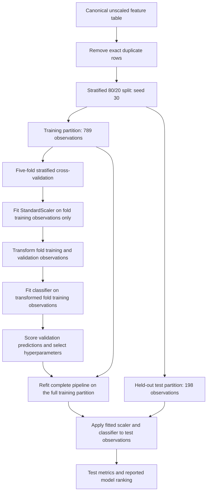

# 4 Data Exploration, Standardization, and Normalization

## 4.1 Introduction

Chapter 3 established the structure, meaning, and documentation of the data used in this study. The next methodological step is to determine what their observed properties imply for preparation before modelling. This chapter examines data completeness, class distribution, numerical distributions, feature relationships, exact duplicate rows, and potential extreme observations. The purpose is to connect each observation to a justified preprocessing decision, while distinguishing exploratory findings from evidence obtained through classifier evaluation.

The project operates on source audio recordings and their derived tabular feature representation. Consistency is therefore required at two levels: the same extraction logic must produce comparable descriptors for every recording, and the resulting numerical columns must be prepared appropriately for the models that consume them. Here, *data exploration* means inspecting the feature table to identify quality issues and statistical structure. *Structural standardization* means maintaining consistent observation units, feature definitions, column names, and labels. *Normalization* concerns numerical rescaling according to a defined rule, applied either to individual features or to complete observation vectors. The implemented feature-wise transformation is specifically *Z-score standardization*. Min-Max normalization and L2 normalization are discussed separately because they change the representation in different ways.

The analysis combines the existing EDA report with the preprocessing documentation and the current experimental implementation. The original exploratory figures describe the initial table, whereas model preparation includes subsequent duplicate removal and training-specific transformations. This distinction is necessary to explain both the value of exploratory scaling and the prevention of information leakage during fitting. The evaluation limitation already established in Chapters 1–3, concerning model ranking using test results, remains part of the methodological account.[^ch4-context][^ch4-eda][^ch4-preprocessing]

## 4.2 Data Exploration

### 4.2.1 Exploration Procedure

The exploration began with the canonical unscaled feature table, `data/features_extended.csv`. The script `src/eda.py` reads the table with pandas, displays its first rows, reports column types and dimensions, and counts missing values. It then examines genre frequencies, distributions of global audio descriptors, MFCC and chroma statistics, pairwise correlations, and an exploratory PCA projection. Matplotlib and seaborn provide the visualizations; scikit-learn supplies scaling and PCA. NumPy supports the numerical aggregation used in feature extraction and the verification of feature statistics.[^ch4-eda-code][^ch4-extraction]

The procedure can be summarized in six steps:

1. Inspect the table dimensions and types, separating the numerical predictors from the categorical target.
2. Check missing values and inspect the target distribution to determine whether imputation or class resampling is justified.
3. Examine histograms of global audio descriptors and boxplots of MFCC and chroma statistics to compare distribution shapes, numerical ranges, and potential extreme observations.
4. Compute the correlation matrix of selected global audio descriptors to identify pairwise relationships and possible redundancy.
5. Standardize the MFCC and chroma subset for a two-dimensional exploratory PCA visualization.
6. Apply the subsequent modelling-stage validation, including exact duplicate detection and removal before partitioning the data.

These steps span exploration and the validation that followed it. In particular, duplicate counting and removal are implemented in `load_clean_dataset()` in `src/project_config.py`; they are not operations performed by the plotting script itself. The initial table has 1,000 observations and 62 columns, including 61 numerical predictors. This confirms the schema documented in Chapter 3 without introducing a different analytical unit.[^ch4-loader]

Figures 4.1–4.6 reproduce selected original plots extracted from the version 2 EDA report. They retain the initial 1,000-observation scope and are renumbered for this chapter. Consequently, they should not be interpreted as distributions calculated after duplicate removal or as visualizations of the training partition alone.

### 4.2.2 Data Completeness and Class Distribution

The column-wise checks found no missing values in the feature table. No imputation was therefore needed, and the implemented modelling pipelines contain no imputer. The shared loader raises an error if missing values are encountered instead of silently replacing them. Median imputation discussed in the preprocessing report is a possible response to future missingness, not a transformation applied to the present data.[^ch4-preprocessing][^ch4-loader]

Figure 4.1 shows the initial genre distribution. Each label has 100 observations, so the original table contains no majority class that would justify balancing through oversampling or undersampling.

**Figure 4.1. Initial distribution of genre labels.** Counts in the initial feature table, before exact duplicate removal. Source: EDA report, original Figure 1, PDF page 2.[^ch4-eda]

After cleaning, class sizes range from 93 to 100 observations, as detailed in Table 3.3. Thus, the data remain approximately balanced, although the class counts are no longer identical. No additional class resampling was introduced. Stratification was retained in the train-test split and cross-validation so that the partitions preserve approximately the same class proportions. Balance does not establish that all genres are equally difficult to classify; it only removes a clear frequency-based reason for altering the number of examples in each class.

### 4.2.3 Numerical Feature Distributions

The distribution analysis reveals differences both in shape and in numerical scale. The EDA script uses 30-bin histograms with overlaid kernel density estimates for the global audio descriptors. Figures 4.2–4.4 present three representative examples. Their vertical axes show observation counts; the smooth curves assist visual interpretation rather than establish a fitted probability model.[^ch4-eda-code]

Figure 4.2 shows that tempo estimates concentrate around the middle of the observed range, with unevenly populated intervals and a smaller upper tail. The canonical table contains estimates from approximately 69.8 to 184.6 BPM. This is variation in the extractor's tempo estimates; the pooled histogram alone does not establish a tempo rule for any particular genre.[^ch4-feature-data]

**Figure 4.2. Distribution of tempo.** Recording-level tempo estimates in BPM for the initial table. Source: EDA report, original Figure 2, PDF page 3.[^ch4-eda]

Mean RMS energy occupies a very different scale. Its observed values extend from approximately 0.0053 to 0.3977 in the waveform amplitude scale. Figure 4.3 shows an asymmetric distribution with a longer upper tail and relatively few observations at its high end. Although the original plot uses the label “RMS Energy,” this descriptor is a root-mean-square amplitude statistic, not calibrated sound pressure or a direct measurement of perceived loudness. The distribution does not demonstrate that recordings were loudness-normalized.[^ch4-feature-data][^ch4-extraction]

**Figure 4.3. Distribution of mean RMS energy.** Mean frame-level RMS amplitude per recording, expressed on the digital signal amplitude scale. Source: EDA report, original Figure 3, PDF page 4.[^ch4-eda]

The mean spectral centroid in Figure 4.4 spans approximately 570 to 4,436 Hz. Its broad distribution has a main concentration near 2,400 Hz and a less densely populated upper tail. Compared with RMS, its numerical values differ by several orders of magnitude. These different units and ranges create a modelling problem: a large numerical difference in hertz could dominate a distance calculation even when a smaller numerical difference in another descriptor is informative.[^ch4-feature-data]

**Figure 4.4. Distribution of mean spectral centroid.** Mean frame-level spectral centroid per recording, in Hz, for the initial table. Source: EDA report, original Figure 5, PDF page 5.[^ch4-eda]

The MFCC and chroma boxplots in the EDA report extend this comparison to groups of related features without requiring a separate histogram for every predictor. MFCC means have component-specific centres and spreads, including signed values. For example, `mfcc_1_mean` ranges from approximately −552.2 to 42.1 in the initial table and has an extended negative tail. By comparison, `chroma_1_mean` ranges from approximately 0.047 to 0.787, and the chroma components occupy more similar numerical ranges. The boxplots also display observations beyond their whiskers. As noted in Chapter 3, the two MFCC captions on PDF page 9 are reversed; their plotted column names identify the corresponding means and standard deviations.[^ch4-eda][^ch4-feature-data]

The preprocessing consequence is to preserve these continuous descriptors while adjusting their relative scales for scale-sensitive models. The observations do not justify forcing every feature into a Gaussian distribution or deleting values solely because they are uncommon. Z-score standardization addresses differences in location and spread; it does not remove skewness or eliminate extreme observations.

### 4.2.4 Correlation Analysis

The correlation matrix in Figure 4.5 was computed for 11 global audio descriptors: tempo and the mean and standard deviation of RMS, zero-crossing rate, spectral centroid, spectral bandwidth, and spectral rolloff. It uses Pearson correlation, as implemented by the default pandas `corr()` call in the EDA script. The figure therefore describes a selected subset of the feature table, rather than all 61 predictors.[^ch4-eda-code]

**Figure 4.5. Correlation matrix of selected global audio descriptors.** Pearson correlation coefficients calculated on the initial table; both cell annotations and the colour scale represent dimensionless correlations. Source: EDA report, original Figure 17, PDF page 11.[^ch4-eda]

Several spectral relationships are strong. The correlation between `spectral_centroid_mean` and `spectral_rolloff_mean` is approximately 0.98; between `spectral_bandwidth_mean` and `spectral_rolloff_mean`, approximately 0.95; and between `spectral_centroid_mean` and `spectral_bandwidth_mean`, approximately 0.90. These rounded values are consistent with direct calculation from the canonical table. The weaker language in the PDF's accompanying prose is therefore not adopted here.[^ch4-feature-data][^ch4-eda]

The relationships indicate partial redundancy among descriptors of spectral energy distribution. They also mean that interpreting one descriptor independently of the others requires care. However, a high pairwise correlation does not by itself establish that a variable contributes no useful information to classification. Strong pairwise relationships were therefore not treated as sufficient justification for removing predictors before modelling. The initial model input retained all 61 engineered audio descriptors. Feature selection was subsequently evaluated as a separate pipeline variant, with its fitting restricted to training data; the detailed comparison belongs to the modelling chapter.[^ch4-preprocessing][^ch4-target]

Standardization does not remove these correlations. It changes the location and scale of each variable, while retaining its linear relationships with other variables. Scaling and redundancy assessment consequently address different methodological problems.

### 4.2.5 Exploratory PCA

Exploratory PCA was used to inspect the feature space in two dimensions. The input was specifically the MFCC and chroma subset: 13 MFCC means, 13 MFCC standard deviations, 12 chroma means, and 12 chroma standard deviations, giving 50 variables. In `src/eda.py`, these columns are standardized across the initial table with `StandardScaler`, after which `PCA(n_components=2)` produces the plotted coordinates. Genre labels supply the point colours and do not enter the PCA fit.[^ch4-eda-code]

**Figure 4.6. Exploratory PCA projection of MFCC and chroma features.** Two principal-component coordinates derived from 50 globally standardized MFCC and chroma variables for the initial 1,000 observations; colours identify genre labels. Source: EDA report, original Figure 18, PDF page 12.[^ch4-eda]

Figure 4.6 shows partial structure together with substantial overlap. For example, many classical observations occupy the lower part of the projection, while many metal observations extend toward larger values of the first component. Several other labels overlap in the central region. These are descriptive tendencies within a projection that preserves only two directions of variation. The PDF and plotted axes do not report the explained-variance ratios, so the figure is not assigned an unsupported percentage of retained information.

Overlap in two dimensions does not establish that classes are inseparable in the full feature space, nor does it prove that an RBF SVM must outperform a linear classifier. The projection motivates empirical classifier comparison rather than determining the model choice in advance. PCA was not included in the final preprocessing pipeline. The globally fitted scaler and PCA used for this visualization were exploratory objects and were not transferred into model evaluation.[^ch4-baselines][^ch4-target]

### 4.2.6 Duplicate and Outlier Analysis

The modelling-stage validation identifies 13 exact duplicate rows in the canonical unscaled feature table. The operation compares complete rows, including `genre`, and uses `drop_duplicates()` to retain the first occurrence of each distinct row. It then resets the row index. Removing these entries before the train-test split leaves 987 observations.[^ch4-loader][^ch4-feature-data]

The methodological problem is that retained identical entries could be distributed across fitting and evaluation partitions. Removing exact duplicate rows prevents this particular repetition from crossing the split. The count describes repeated tabular entries; the operation does not establish the identity of the underlying recordings. Numerical row equality is not an audio fingerprinting procedure, and the feature table does not provide recording identifiers or artist metadata for a comprehensive investigation. The cleaning therefore does not detect all near-duplicates, establish artist independence, or remove every potentially related recording. These limitations remain consistent with Chapters 2 and 3.

The MFCC and chroma boxplots also identify potential extreme observations. Values beyond the whiskers indicate unusual positions relative to a feature's distribution, but they do not independently establish extraction errors. In audio descriptors, substantial variation can reflect differences in signal content or recording characteristics. The documented material provides no case-level evidence that would justify treating all such observations as invalid.[^ch4-eda]

No arbitrary outlier deletion, clipping, or winsorization was introduced. Observations were retained unless a documented extraction or data-quality error justified exclusion; no additional outlier-related exclusion is recorded for the current feature table. The 987-observation count consequently reflects exact duplicate removal, not an unreported combination of duplicate and outlier filtering.

## 4.3 Data Standardization

### 4.3.1 Structural Standardization of the Feature Table

Structural standardization gives every observation the same interpretation. One row represents one recording, with the same set of 61 numerical predictors and one target column, `genre`. The codebook in Table 3.4 defines those variables; the present section concerns the consistency that allows the table to serve as a shared modelling interface.

Column names identify descriptor families and aggregation statistics consistently. The `_mean` suffix denotes the mean of a descriptor across frames of one recording, and `_std` denotes its corresponding within-recording standard deviation. These suffixes do not describe variation between recordings or across validation folds. Tempo remains one recording-level estimate rather than a mean-and-standard-deviation pair. Genre values belong to the established ten-class schema, and the target is separated from the predictors before model fitting.[^ch4-extraction][^ch4-loader]

This common structure allows every classifier to receive columns with the same meanings. It also distinguishes feature extraction from numerical scaling: the aggregation statistics define what a predictor measures, while the later scaler changes the numerical representation of that predictor across training observations.

### 4.3.2 Audio-to-Feature Processing Consistency

The extraction script processes each `.wav` file through the same function. Audio is loaded using `librosa.load(file_path, sr=None)`, producing a waveform and its source sampling rate. No explicit resampling to a common sampling rate was applied in the documented extraction procedure. Instead, each file was loaded at its source rate and processed using the same descriptor-extraction logic.[^ch4-extraction]

For every recording, the extractor obtains one tempo estimate, computes zero-crossing rate and RMS, calculates spectral centroid, bandwidth, and rolloff, and extracts 13 MFCC and 12 chroma components. Apart from the single tempo estimate, frame-level values are summarized with NumPy means and standard deviations. The same functions, component counts, naming rules, and aggregation procedure are used for each file. Where required, the source sampling rate is passed to the descriptor function, including the spectral, MFCC, chroma, and tempo calculations.

The procedure does not contain a separate silence-trimming or loudness-normalization stage. No separate channel-conversion procedure was configured: the loading call leaves channel handling at the library default. In the recorded librosa version, `mono=True` is the default, so the absence of an explicit argument must not be interpreted as preservation of stereo channels. This documents the behaviour of the loading call without asserting the original channel count of every source recording.[^ch4-extraction][^ch4-environment]

Processing consistency therefore means applying the same extraction logic, not demonstrating that the original recordings have identical acquisition characteristics. Furthermore, preserving source sampling rates does not guarantee an identical frame duration in seconds when a library's default frame length is expressed in samples. The available implementation supports a consistent descriptor procedure, while the missing file-level audio inventory limits stronger claims about uniform source conditions.

### 4.3.3 Label and Schema Consistency

The extractor derives `genre` from the containing folder name and appends it to the numerical descriptors. In the current table, these names match the ten labels documented in Chapter 3. The CSV is the canonical tabular representation, and all predictor columns are numerical. Since the only categorical field is the target, no categorical predictor encoding was required; the classifiers accept the genre labels as strings.[^ch4-extraction][^ch4-preprocessing]

The fixed ten-class schema describes the current data and expected interface. It should not be confused with an additional validator: the shared loader explicitly checks for missing values and the target column, but does not implement a separate assertion against a hard-coded list of ten genres. Structural consistency in the current table is therefore an observed property supported by the extraction convention and data inspection.

## 4.4 Data Normalization

### 4.4.1 Need for Numerical Scaling

In this chapter, normalization refers to the consideration of numerical scaling strategies before modelling. The selected procedure is Z-score standardization; Min-Max normalization and row-wise L2 normalization are distinct alternatives. These terms are not used interchangeably.

The distributions in Section 4.2.3 show why scaling matters. Tempo is measured in BPM, spectral descriptors in hertz, RMS on a signal amplitude scale, MFCC in coefficient values, and chroma as a dimensionless representation. Their numerical ranges consequently differ even when all columns are valid. Without adjustment, the geometry of the predictor space depends strongly on the units and spreads of individual variables. This motivates feature-wise scaling for the distance and regularization calculations used by scale-sensitive models.

### 4.4.2 Z-score Standardization

For each numerical predictor, Z-score standardization is defined as

\[
z = \frac{x-\mu_{\mathrm{train}}}{\sigma_{\mathrm{train}}}.
\]

Here, \(\mu_{\mathrm{train}}\) is the mean estimated exclusively from the relevant training observations, and \(\sigma_{\mathrm{train}}\) is the corresponding training standard deviation. During cross-validation, these observations are the training portion of the current fold. During the final fit, they are the full training partition. Validation and test values are transformed using the already fitted parameters, without recomputing them on the evaluated observations.

The implementation uses `StandardScaler` with its default centring and variance scaling. Its standard deviation uses a divisor of \(n\), corresponding to `ddof=0`. For non-constant columns, the transformed data on which the scaler was fitted have mean approximately zero and standard deviation approximately one, allowing for numerical precision. The resulting values are dimensionless. The same moments are not guaranteed for validation or test data, because those observations can have different distributions.[^ch4-baselines][^ch4-target]

This transformation is appropriate for the RBF SVM because it makes differences along individual feature axes more comparable. It also supports logistic regression by reducing the dependence of regularized coefficient estimation on the original measurement scales. In exploratory PCA, standardization prevents a variable's larger original variance from determining the projection merely through its units. In the implemented PCA visualization this applies only to the MFCC and chroma subset described in Section 4.2.5.

Z-score standardization does not constrain values to a fixed interval or make a skewed distribution Gaussian. Negative transformed RMS or frequency values indicate observations below the training mean, not invalid negative amplitudes or frequencies in the original data.

### 4.4.3 Why StandardScaler Was Selected

The transformation was selected because the feature families have substantially different scales and the principal scale-sensitive models use those magnitudes directly. The RBF kernel depends on squared distances between observations. Without feature-wise scaling, a descriptor measured in thousands of hertz could contribute much more to those distances than a chroma descriptor with sub-unit values. Standardization reduces this dependence on measurement scale while retaining the ordering and continuous variation of each feature.[^ch4-preprocessing]

Making feature scales comparable does not guarantee equal predictive importance. A standardized variable can remain uninformative, redundant, or unusually variable in a particular subset. `StandardScaler` also depends on means and standard deviations, so it is sensitive to extreme observations. The decision to retain such observations does not imply that their influence has been removed by scaling.

Tree-based classifiers do not require scaling in the same way because their threshold rules depend on feature ordering. Nevertheless, the current baseline implementation places `StandardScaler` in every classifier pipeline, including the tree ensembles and dummy classifier, to maintain a common implementation structure. This is an implementation choice, not a claim that scaling is necessary for those models. No controlled comparison of scaled and unscaled versions was performed in the documented experiment, so improved classification accuracy is not attributed to standardization alone.[^ch4-baselines]

### 4.4.4 Min-Max Normalization Consideration

For a non-constant feature, Min-Max normalization to the interval \([0,1]\) is defined as

\[
x' = \frac{x-x_{\min}}{x_{\max}-x_{\min}}.
\]

In a valid experimental pipeline, \(x_{\min}\) and \(x_{\max}\) would be estimated from the relevant training observations. The fitted interval describes those observations; a later value outside their range can transform to a value below zero or above one.

Min-Max normalization was considered in the preprocessing documentation but was not selected as the default transformation. Its dependence on the observed extrema can compress most observations into a narrow interval when a feature has a long tail or a small number of extreme values. The observed descriptor distributions and the requirements of the selected scale-sensitive models motivated Z-score standardization as the more appropriate default for this study.[^ch4-preprocessing]

This is a methodological justification, not the result of a `MinMaxScaler` versus `StandardScaler` performance experiment. Neither a Min-Max pipeline nor such a comparison is present in the documented experimental implementation.

### 4.4.5 L2 Normalization Consideration

L2 normalization rescales an entire observation to unit Euclidean length, using \(\mathbf{x}'=\mathbf{x}/\lVert\mathbf{x}\rVert_2\) for a non-zero vector. This is a row-wise operation, unlike the feature-wise centring and scaling used in the experiment.

Each row here contains heterogeneous acoustic descriptors whose magnitudes retain feature-specific meaning. The experiment therefore did not reformulate each complete observation as a unit-length vector. L2 normalization was not used, and no comparison supporting its adoption is documented. This concerns the complete classifier input vector; it does not imply that individual audio-descriptor functions contain no internal normalization.

### 4.4.6 Before-and-After Comparison

Table 4.1 illustrates the implemented transformation using five representative predictors. The values were calculated from the existing canonical unscaled feature table with the same cleaning and splitting procedure as the model scripts. Specifically, exact duplicate rows were removed while retaining the original order of their first occurrences, the index was reset, and `train_test_split` was applied with `test_size=0.2`, `stratify=y`, and `random_state=30`. `StandardScaler` was then fitted on all 61 columns of the resulting 789-observation training partition, and the five displayed columns were selected for reporting.[^ch4-feature-data][^ch4-loader][^ch4-config]

**Table 4.1. Selected feature statistics before and after training-set standardization.**

| Feature | Original training mean | Original training standard deviation | Standardized training mean | Standardized training standard deviation |
|---|---:|---:|---:|---:|
| `tempo` | 121.333768 | 20.812651 | ≈ 0.000000 | 1.000000 |
| `rms_mean` | 0.131596 | 0.065703 | ≈ 0.000000 | 1.000000 |
| `spectral_centroid_mean` | 2194.729685 | 707.692213 | ≈ 0.000000 | 1.000000 |
| `mfcc_1_mean` | −143.920526 | 99.716712 | ≈ 0.000000 | 1.000000 |
| `chroma_1_mean` | 0.385469 | 0.113257 | ≈ 0.000000 | 1.000000 |

Source: calculation from `data/features_extended.csv` using the configured cleaned training split. Standard deviations use `ddof=0`, consistent with `StandardScaler`; values are rounded to six decimal places. Original statistics retain the feature-specific units or scales, while standardized statistics are dimensionless.[^ch4-feature-data][^ch4-config]

Table 4.1 shows the intended change in scale: original standard deviations range from fractions of one to hundreds, while the standardized columns have unit training standard deviation. The near-zero means reflect centring, not removal of the original distribution shapes. The table documents the transformation corresponding to a fit on the full training partition; during cross-validation, separate scalers are fitted within the folds. This descriptive calculation does not alter the experimental split, train new classifiers, or use the held-out test partition to estimate scaling parameters.

## 4.5 Integration of Different Data Types

The integration problem is the connection between source audio, derived numerical descriptors, and target information. Each WAV recording is processed by the `librosa` extractor to produce 61 numerical values. The genre folder name supplies the target label, and the extractor combines these into one tabular observation. This is the audio-to-table relationship shown in Figure 3.1, with the shared feature schema providing the interface to subsequent processing.[^ch4-extraction]

The classifier receives one fixed-length vector per recording. Consequently, there is no alignment by timestamps across independently acquired text, image, video, or audio modalities. Frame-level audio information is aggregated within each recording before the observation enters the table. This integration simplifies the input interface, while retaining the representational limitation that temporal ordering is lost.

Markdown reports, JSON configuration and manifests, PDF figures, and source-code files document or control the research procedure. They are not additional model inputs. Likewise, genre names are target annotations rather than textual predictors. The study therefore integrates audio-derived measurements with their labels without claiming a separate multimodal learning system.

## 4.6 Documentation and Reproducibility

### 4.6.1 Scripted Processing

The preparation was implemented through scripts rather than manual spreadsheet transformations. `src/extract_features.py` defines the waveform-to-descriptor transformation, `src/eda.py` implements the exploratory plots, and `src/project_config.py` centralizes configuration access, duplicate removal, and missing-value checks. `src/baseline_models.py` and `src/target_model.py` place scaling and classifier fitting in scikit-learn pipelines. `src/results_analysis.py` reuses the same cleaned input and split when producing the later analytical outputs.[^ch4-extraction][^ch4-eda-code][^ch4-loader][^ch4-baselines][^ch4-target][^ch4-analysis]

The consolidated workflow uses `experiment_config.json` to specify the canonical input, target column, random seed, test fraction, and cross-validation settings. As documented in Chapter 3, the manifest records source, configuration, and feature-table hashes together with execution metadata. These records identify the relevant artifacts, but reproducing an execution still requires their matching contents. The older exploratory training scripts are not the basis for the final preprocessing account.[^ch4-config][^ch4-organization][^ch4-environment]

### 4.6.2 Leakage Prevention

The implemented sequence begins with the canonical unscaled feature table. Exact duplicate rows are removed before a stratified 80/20 split with `random_state=30`, producing a training partition of 789 observations and a held-out test partition of 198 observations. Five-fold stratified cross-validation operates on the training partition, using `StratifiedKFold(n_splits=5, shuffle=True, random_state=30)`.[^ch4-loader][^ch4-baselines][^ch4-target]

Within each cross-validation fold, the pipeline fits `StandardScaler` only on that fold's training observations. It transforms the training and validation observations using those parameters, fits the classifier on the transformed training data, and evaluates predictions for the validation data. When the feature-selection variant is evaluated, its selector is also fitted inside the same pipeline. Fitting a scaler once on the entire training partition before cross-validation would still expose each validation fold to its own distribution; the pipeline avoids that intermediate form of information leakage.

Figure 4.7 develops the preprocessing portion of Figure 3.1. It distinguishes fold-level fitting from the final refit and application to the held-out test partition.

**Figure 4.7. Preprocessing and fitting boundaries in the experimental workflow.** Detail of the data-flow diagram in Figure 3.1, adapted to show fold-specific scaling, final refitting, and test application. Source: the shared loader and current baseline and target-model pipelines. The final ranking uses test results, as qualified below.[^ch4-loader][^ch4-baselines][^ch4-target]

After hyperparameter selection within a search, `GridSearchCV` refits the selected complete pipeline on the full training partition. Test observations are transformed with the resulting training-derived means and standard deviations. They do not contribute to scaler fitting or classifier parameter fitting. Default baseline pipelines follow the same separation between cross-validation and fitting on the complete training partition.

These fitting safeguards must be distinguished from independence of model selection. The implemented reports rank model variants by test accuracy and test macro F1 when identifying the best reported models. The test partition is therefore held out from fitting, but it is not independent of every selection decision. Figure 4.7 retains that final use explicitly, consistent with Chapters 1–3. Correctly nested preprocessing prevents a specific form of information leakage; it does not resolve the separate limitation of test-based ranking.[^ch4-context][^ch4-baselines][^ch4-target][^ch4-analysis]

### 4.6.3 Exploratory and Experimental Data Separation

`data/features_extended.csv` is the canonical unscaled feature table and the configured input to the final experiments. “Unscaled” refers to the extracted descriptors: the file is already derived from audio, but its columns have not undergone training-set standardization. Each model script obtains this input through the common loader and learns the required transformations within its training procedure.

`data/features_extended_scaled.csv` is a globally scaled exploratory table. It contains the initial observations with numerical values consistent with standardization over the full initial dataset. Because its scaling parameters include observations that later enter evaluation partitions, it cannot supply the required fold-specific preprocessing for model evaluation. It is excluded from the final modelling input.[^ch4-feature-data][^ch4-preprocessing][^ch4-config]

The current EDA script separately standardizes its MFCC and chroma subset in memory for PCA; it does not write the globally scaled CSV. Both uses belong to exploration. Neither the stored exploratory table nor the fitted objects used for the PCA visualization are reused as training preprocessing. This separation preserves the descriptive value of the existing figures while maintaining the implemented fitting boundaries.

### 4.6.4 Software Environment

The recorded environment uses Python 3.14.0, librosa 0.11.0, NumPy 2.3.5, pandas 2.3.3, scikit-learn 1.8.0, Matplotlib 3.10.8, and seaborn 0.13.2. The first five entries are confirmed by the experiment manifest, while the plotting-library versions are specified in `requirements.txt` and the consolidated environment documentation. These version records support interpretation of library defaults and reproduction of the numerical workflow without repeating the hardware description from the project documentation.[^ch4-environment][^ch4-organization]

## 4.7 Summary

Exploration identified a complete, initially balanced feature table with heterogeneous numerical scales, strong relationships among selected spectral descriptors, potential extreme observations, and partial structure in the MFCC and chroma projection. The resulting preprocessing decisions were selective: remove exact duplicate rows, retain the remaining observations and initial predictor set, and fit Z-score standardization within the model pipelines. Neither imputation nor class resampling was justified by the observed data.

Table 4.2 connects these findings to the implemented decisions and the alternatives that were not adopted.

**Table 4.2. Summary of exploratory findings and preprocessing decisions.**

| EDA finding / issue | Final decision |
|---|---|
| No missing values | No imputation; reject missing values if encountered by the modelling loader. |
| Approximately balanced classes after cleaning | No oversampling or undersampling; retain stratified partitioning. |
| 13 exact duplicate rows | Remove before the train-test split; retain 987 observations. |
| Potential extreme observations | No automatic outlier deletion or clipping without documented data-quality evidence. |
| Strongly different numerical scales | Use Z-score standardization for scale-sensitive models; the implemented baseline pipelines also retain the common scaler step. |
| Strong correlations among selected spectral descriptors | Retain predictors initially; do not remove them solely on the basis of EDA correlations. |
| PCA shows partial structure and overlap | Use the MFCC and chroma projection for exploratory visualization only. |
| Min-Max normalization | Considered as an alternative, but not selected or compared experimentally. |
| L2 normalization | Not used for the complete heterogeneous feature vector. |
| Information leakage through learned transformations | Fit scaling and any evaluated feature selection inside training pipelines and cross-validation folds. |
| Globally scaled exploratory table | Keep separate from the canonical unscaled feature table; exclude from final modelling input. |

Table 4.2 describes the actual data interface and fitting controls, rather than asserting that every possible source of dependence has been removed. Near-duplicate recordings and artist overlap remain outside the scope of exact duplicate-row removal, and test-based model ranking retains the limitation established in the preceding chapters. The resulting preprocessing decisions define the data interface used by the implementation and modelling stages described in the following chapters.

## Documentation References

The following references connect the chapter to the completed research, current implementation, and existing numerical artifacts. The descriptive calculations in this chapter verify properties of those inputs without rerunning the classifier experiments.

[^ch4-context]: [Chapter 1: Introduction](01.md), Section 1.4; [Chapter 2: Literature Review](02.md), Sections 2.5.1–2.5.2; and [Chapter 3: Dataset, Data Types, and Documentation](03.md), especially Sections 3.4, 3.6, and 3.8, for the data schema, interpretation of the original EDA figures, and limitations of duplicate removal and test-based model ranking.

[^ch4-eda]: [Data Preparation and Exploratory Data Analysis, version 2](../PDF/eda_s27833_2026v2.pdf), Sections 5.1–5.12, PDF pages 1–13. Figures 4.1–4.6 reproduce the embedded images of original Figures 1, 2, 3, 5, 17, and 18 on PDF pages 2, 3, 4, 5, 11, and 12, respectively. MFCC and chroma boxplots are on pages 9–10. MFCC statistics are identified from the plotted variable names because the captions of original Figures 13 and 14 are reversed. Correlation interpretation follows the heatmap values; PCA interpretation is restricted to the displayed projection.

[^ch4-preprocessing]: [Assignment 6: Feature Engineering and Preprocessing](../docs/assignment6.md), especially Sections B–F, for missing-value handling, scaling rationale, Min-Max consideration, exploratory data, and the distinction between adopted procedures and potential extensions.

[^ch4-eda-code]: [Exploratory analysis script](../src/eda.py), for table inspection, count plots, 30-bin histograms, MFCC and chroma boxplots, Pearson correlations of 11 global descriptors, and standardized two-component PCA of 50 MFCC and chroma variables.

[^ch4-extraction]: [Feature extraction implementation](../src/extract_features.py), especially `FEATURES`, `extract_features()`, and the genre-folder processing loop, for audio loading with `sr=None`, descriptor calculation, component counts, aggregation, and label assignment.

[^ch4-loader]: [Shared configuration and data-loading implementation](../src/project_config.py), especially `load_clean_dataset()`, for full-row duplicate counting and removal, index resetting, missing-value rejection, and separation of predictors from the target.

[^ch4-feature-data]: [Canonical unscaled feature table](../data/features_extended.csv) and [globally scaled exploratory table](../data/features_extended_scaled.csv). Numerical ranges and correlations in Section 4.2 were verified on the initial unscaled table. Table 4.1 was calculated only on the cleaned training partition using the procedure in Section 4.4.6, with population standard deviations (`ddof=0`). The exploratory table's values were checked against standardization of the full initial numerical table.

[^ch4-config]: [Shared experiment configuration](../experiment_config.json), for the canonical feature path, target column, seed 30, test fraction 0.2, and five cross-validation folds.

[^ch4-baselines]: [Baseline implementation](../src/baseline_models.py) and [Assignment 7: Baseline Models](../docs/assignment7.md), Section 2, for common splitting, pipeline-based scaling, stratified cross-validation, and final fitting. The implementation's sorting by `test_accuracy` and `test_f1_macro` establishes the qualification concerning reported model ranking.

[^ch4-target]: [Target-model implementation](../src/target_model.py) and [Assignment 8: Target Model and Optimization](../docs/assignment8.md), Sections 3–4, for scaling inside `Pipeline`, the separately evaluated `SelectKBest` variant, training-partition grid search, refitting, and test-based ranking of reported variants.

[^ch4-analysis]: [Results-analysis implementation](../src/results_analysis.py) and [Assignment 9: Results Analysis and Interpretation](../docs/assignment9.md), for reuse of the common input and split and consolidation of model outputs. No final classifier scores are required for the preprocessing decisions presented here.

[^ch4-organization]: [Assignment 4: Reproducibility and Code Organization](../docs/assignment4.md), Sections A–E, for the consolidated workflow, shared configuration, dependency versions, and experimental traceability. This consolidated organization supersedes older references to exploratory training scripts and locally embedded audio paths.

[^ch4-environment]: [Experiment manifest](../docs/experiment_manifest.json) and [pinned dependencies](../requirements.txt), for recorded Python and library versions. The channel-handling default was also checked in the installed librosa 0.11.0 implementation of `librosa.core.audio.load`; the extraction script supplies `sr=None` and leaves `mono` unspecified.
