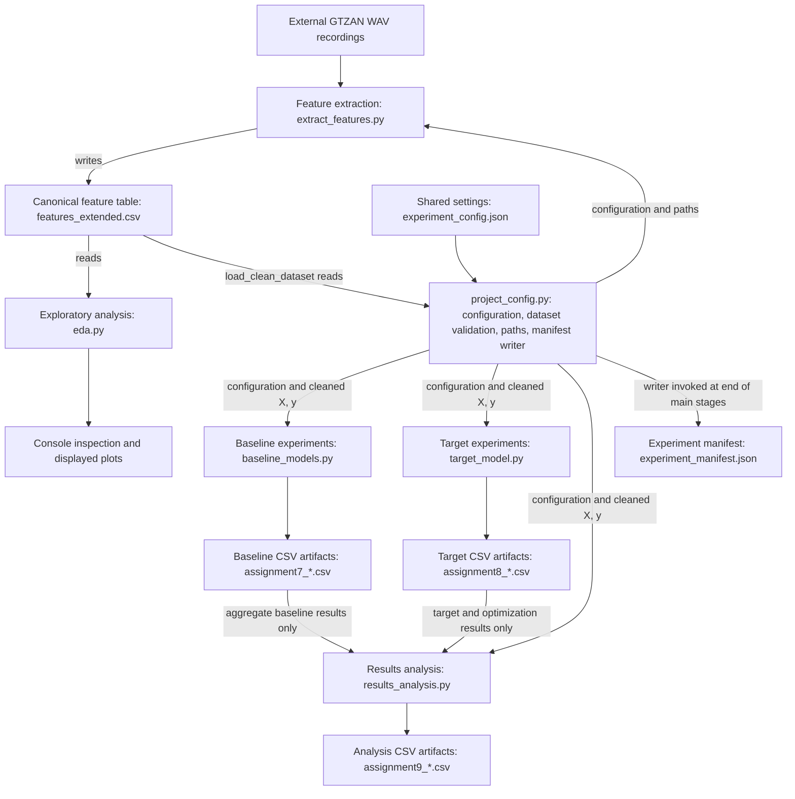

# 5 IT System Architecture

## 5.1 Introduction

The architecture of the music genre classification system defines how audio processing, data preparation, model experimentation, and result interpretation are organized into an executable research workflow. It specifies component responsibilities, data interfaces, execution dependencies, and the records needed to inspect and reproduce an experiment. These concerns connect the dataset described in Chapter 3 and the preprocessing rules established in Chapter 4 to the model implementation discussed in Chapter 6.

The implemented system is a local Python research pipeline. Its principal products are a numerical feature table and experimental reports, rather than a continuously running prediction service. This chapter describes the current source code, configuration, and saved artifacts. Earlier project reports provide design context, but statements about implemented behaviour follow the current scripts where the reports describe an earlier arrangement or a planned procedure.[^ch5-context][^ch5-organization]

## 5.2 System Requirements and Architectural Assumptions

The functional scope covers the transformation of externally stored WAV recordings into features, exploration of those features, controlled classifier experiments, and generation of analytical outputs. The principal user is a researcher who can configure a Python environment, execute scripts, and interpret tabular results. The workflow assumes local access to the repository and, when extraction is required, to a genre-organized audio directory. Model experiments can instead begin from the existing canonical feature table.[^ch5-readme]

The non-functional requirements concern reproducibility, maintainability, data integrity, computational efficiency, modularity, and extensibility. These are supported to different degrees: for example, recording input hashes improves traceability, but does not establish complete reproducibility of an uncommitted source state. Table 5.1 links each requirement to its implementation and identifies partial support.

**Table 5.1. Functional and non-functional requirements of the system.**

| Type | Requirement | Existing implementation and qualification |
|---|---|---|
| Functional | Audio feature extraction | `extract_features.py` reads WAV recordings and derives 61 numerical descriptors and the folder-based `genre` label. Source audio must be supplied externally. |
| Functional | Data validation | The extractor checks expected feature columns; the shared loader removes exact duplicate rows and rejects missing values or a missing target column. Validation is partial: it does not enforce the full predictor schema or permitted genre set. |
| Functional | Exploratory data analysis | `eda.py` inspects the canonical table and displays distributions, correlations, and a PCA projection. It has no automated figure-export or manifest step. |
| Functional | Dataset preparation | The shared loader supplies cleaned predictors and labels; each experiment script recreates the configured stratified split. Scaling and optional feature selection belong to fitted model pipelines. |
| Functional | Baseline experimentation | `baseline_models.py` evaluates five default classifiers and tuned variants of four classifier families under common split and cross-validation settings. |
| Functional | Target model optimization | `target_model.py` searches RBF SVM configurations with all features and with `SelectKBest`, and evaluates a separately fitted Random Forest reference. |
| Functional | Results analysis | `results_analysis.py` consolidates existing metrics and produces error, importance, and hyperparameter-stability tables. It also refits a configured SVM for prediction-based analyses. |
| Functional | Experimental output generation | The experiment scripts save CSV tables in the configured output directory. Existing Markdown reports interpret the outputs; the scripts do not generate those narratives. |
| Functional | Configuration and execution records | Four main scripts accept `--config` and invoke the common manifest writer. EDA remains outside this configuration interface. |
| Non-functional | Reproducibility | Shared seeds, dependency pins, configuration, and file hashes identify important execution conditions. Dirty worktrees and missing result-to-run fingerprints limit exact reconstruction. |
| Non-functional | Maintainability | Separate modules and a common utility module localize responsibilities. Repeated splitting and pipeline construction still require coordinated maintenance. |
| Non-functional | Data integrity | Cleaning leaves the canonical input unchanged; extraction uses a temporary file before replacement and rejects an empty extraction. Partial extraction and multi-file output consistency remain insufficiently guarded. |
| Non-functional | Computational efficiency | The compact feature table can be reused without repeated audio decoding; bounded searches and configured parallel jobs support repeated experiments. No throughput or resource-use target is specified. |
| Non-functional | Modularity | Extraction, exploration, model experiments, and analysis have distinct scripts and explicit file interfaces. They share one project environment and are not independently deployed services. |
| Non-functional | Extensibility | Model grids and analysis parameters are configurable, and classifiers use a common tabular interface. New feature schemas or model families still require code and validation changes. |

Source: the six implementation modules, shared configuration, README, and recorded execution metadata.[^ch5-extraction][^ch5-eda][^ch5-shared][^ch5-baselines][^ch5-target][^ch5-analysis][^ch5-config][^ch5-manifest]

These requirements do not introduce quantitative latency, availability, or storage guarantees. The existing evidence supports a bounded experimental workflow, with repeatability dependent on matching inputs, code, configuration, and environment.

## 5.3 Overall System Architecture

The most accurate architectural classification is **modular, script-based batch processing within a single local project**. Each main script performs a finite stage and terminates. The project has a logical separation between data acquisition, experiment execution, and analysis, but these responsibilities are not deployed as separate tiers. Shared Python imports and local files connect the stages. There is no microservice or event-driven execution mechanism in the implemented workflow.[^ch5-readme][^ch5-shared]

Figure 5.1 presents the component structure. It distinguishes the canonical data interface, the independent EDA branch, the shared utility module, and the result-producing experiment stages. The arrows from `project_config.py` identify interfaces used by the scripts; the module is called within their processes and does not schedule their execution.



**Figure 5.1. Overall system architecture.** Solid arrows show data movement or labelled shared utility interfaces. Each of the extraction, baseline, target, and analysis scripts imports `project_config.py` and invokes its manifest writer; EDA does neither. Sources: current component implementations and configuration.[^ch5-extraction][^ch5-eda][^ch5-shared][^ch5-baselines][^ch5-target][^ch5-analysis][^ch5-config]

The absence of an arrow from baseline experiments to target experiments is deliberate. The target script constructs and trains its own default Random Forest reference; it neither imports `baseline_models.py` nor reads its result files. Results analysis is the stage that actually reads selected baseline and target CSV outputs. Likewise, the exploratory scaled table is not shown as an input to any component because none of these six modules consumes it.

This organization is appropriate for the documented dataset and research objective. Stages can be rerun independently, and expensive audio extraction can be omitted when the feature table already exists. A distributed deployment would add service coordination and operational responsibilities without addressing an identified requirement of this local experiment. The chosen simplicity has a cost: the operator coordinates execution order and must keep files from compatible experiments together.

## 5.4 Software Architecture and Component Responsibilities

The six modules divide the implementation by research responsibility. Table 5.2 summarizes their inputs, processing, outputs, and direct dependencies. Here, an output can be an in-memory object, a displayed plot, or a saved file; these forms are distinguished explicitly.

**Table 5.2. Responsibilities and interfaces of the main software components.**

| Component | Responsibility | Input | Processing | Output | Dependencies |
|---|---|---|---|---|---|
| `src/extract_features.py` | Construct the canonical representation | Configured external WAV directory; JSON settings | Sorted directory traversal, audio loading, descriptor calculation and aggregation, folder-label assignment, feature-column check | Canonical CSV through a temporary file; progress and error messages; manifest entry on successful completion | `project_config`; librosa, NumPy, pandas; Python filesystem and argument-parsing facilities |
| `src/eda.py` | Inspect and visualize the initial table | Fixed repository-relative `data/features_extended.csv` | Table inspection, counts, distributions, correlations, standardization and PCA of MFCC/chroma variables | Console summaries and interactive plots; no CSV or automatic plot-file export | pandas, Matplotlib, seaborn, scikit-learn; no internal project-module import |
| `src/project_config.py` | Supply shared infrastructure functions | JSON configuration, canonical CSV, source files, existing manifest, local Git information | Resolve paths, load settings, remove duplicates, reject missing data or target, create output directory, hash files, collect execution metadata | Configuration dictionary; `X`, `y`, duplicate count; paths; updated manifest | pandas and Python standard-library modules, including `json`, `hashlib`, `subprocess`, and `importlib.metadata` |
| `src/baseline_models.py` | Compare classical baseline classifiers | Shared configuration and cleaned dataset | Stratified splitting, pipeline construction, cross-validation, bounded grid searches, fitting, prediction, test-based ranking | Three `assignment7_*.csv` files; console summaries; manifest entry | `project_config`; pandas and scikit-learn |
| `src/target_model.py` | Optimize and compare SVM variants | Shared configuration and cleaned dataset | Pipeline grid searches, independent Random Forest reference, prediction, learning curve, timing, test-based variant ranking | Six `assignment8_*.csv` files; console summaries; manifest entry | `project_config`; pandas, scikit-learn, Python timing facilities |
| `src/results_analysis.py` | Produce consolidated and diagnostic tables | Shared configuration, cleaned dataset, three specific earlier result CSVs | Refit configured SVM, consolidate metrics, calculate errors and permutation importance, select stability-summary rows | Five `assignment9_*.csv` files; completion messages; manifest entry | `project_config`; pandas and scikit-learn |

Sources: component implementations; the output groups are also documented in the README and Assignments 7–9.[^ch5-extraction][^ch5-eda][^ch5-shared][^ch5-baselines][^ch5-target][^ch5-analysis][^ch5-results]

Python supplies script entry points, argument parsing, filesystem operations, and metadata handling. NumPy computes descriptor means and standard deviations during extraction, while librosa loads audio and computes the audio descriptors. pandas provides table loading, filtering, grouping of results, and CSV serialization. Scikit-learn supplies preprocessing, pipelines, classifiers, cross-validation, search, evaluation, PCA, and permutation importance. Matplotlib and seaborn are used in the EDA script for presentation. These roles follow the imports and calls in the project; no separate visualization application is implemented.

The common utility module reduces differences between experiments. `load_config()` reads JSON settings, `project_path()` resolves project-relative paths, and `load_clean_dataset()` applies the same cleaning policy before returning predictors and labels. `output_path()` centralizes output-directory creation, while `write_experiment_manifest()` records execution metadata. However, train-test splitting remains implemented separately in the three experiment scripts. Their agreement follows from their current code and common settings, rather than from one shared split function.[^ch5-shared]

Configuration coverage is substantial but incomplete. `eda.py` uses a fixed canonical path and has no `--config` argument. Extraction writes a literal `genre` field, although the modelling target name is configurable. Furthermore, the `python_version` setting documents the expected runtime without enforcing it, and JSON keys are accessed without a separate configuration-schema validator. These boundaries matter when extending the current workflow.

## 5.5 Data Architecture and Processing Workflow

### 5.5.1 Persistent Inputs and Transient Preparation

The data architecture separates source audio, reusable descriptors, in-memory model data, and experimental outputs. External GTZAN recordings are read from genre folders identified through `AUDIO_DATASET_PATH`. The extractor uses `librosa.load(..., sr=None)` and computes the 61 numerical predictors defined in Chapter 3. The folder name supplies `genre`. The resulting `data/features_extended.csv` is the canonical unscaled interface between audio processing and machine learning; subsequent classifier experiments do not load the waveforms.[^ch5-extraction][^ch5-data]

The initial table contains 1,000 observations, ten genres, and 61 numerical predictors plus the target. The shared loader removes 13 exact duplicate full rows, including their labels, leaving 987 observations in memory. It does not save this cleaned table over the canonical file. With `test_size=0.2`, stratification, and `random_state=30`, the modelling scripts obtain 789 training and 198 test observations. Five-fold stratified cross-validation, with shuffling and the same seed, operates on the training partition in baseline and target experiments.[^ch5-shared][^ch5-config][^ch5-baselines][^ch5-target]

These intermediate partitions and fitted preprocessing objects are not separate persistent datasets. Each script reconstructs them from the canonical CSV and settings. This avoids maintaining several copies of the same split, but makes reproducibility dependent on identical input contents and row order as well as the configured seed. Recording identifiers and saved split assignments are not included in the current data interface.

`data/features_extended_scaled.csv` is an existing exploratory artifact containing the initial observations after global scaling. Assignment 6 associates it with earlier exploration, but the current EDA script does not generate it. Instead, `eda.py` standardizes its 50 MFCC and chroma variables in memory for a two-component PCA plot. Neither the stored scaled table nor the exploratory scaler is used by the final model scripts. The modelling pipelines start from unscaled descriptors and fit their own transformations on the relevant training observations, as established in Chapter 4.[^ch5-preprocessing][^ch5-eda][^ch5-context]

### 5.5.2 Experimental Outputs and Analysis Dependencies

Baseline experiments save aggregate metrics, classification reports, and the best reported baseline's confusion matrix. Target experiments save variant metrics, a reference comparison, search results, a learning curve, a classification report, and a confusion matrix. The existing artifacts contain nine baseline variants, two SVM variants, and 150 target-search rows; these are model or search records, not additional audio observations. Assignment 9 outputs consolidate the eleven variants and provide class errors, misclassification pairs, feature importance, and a summary of selected search configurations.[^ch5-results]

Results analysis consumes exactly three earlier CSVs: `assignment7_baseline_results.csv`, `assignment8_target_results.csv`, and `assignment8_optimization_results.csv`. Its prediction-based analysis follows a separate path: it reloads the canonical dataset and fits `StandardScaler` followed by `SVC` using the configured kernel and `analysis.final_C` and `analysis.final_gamma`. The parameters are not automatically recovered from the winning row of a previous CSV, and no serialized estimator is loaded. Figure 5.2 makes this distinction explicit.[^ch5-analysis]

```mermaid
sequenceDiagram
    participant Run as Command-line invocation
    participant A as results_analysis.py
    participant P as project_config.py
    participant D as Canonical feature CSV
    participant R as Earlier result CSVs
    participant O as Analysis output CSVs
    participant M as Experiment manifest
    Run->>A: Execute with configuration path
    A->>P: Load configuration and cleaned dataset
    P->>D: Read unscaled observations
    D-->>P: Feature table with genre
    P-->>A: Configuration, X, y, duplicate count
    A->>A: Recreate split; fit configured scaler and SVM; predict
    A->>R: Read baseline and target aggregate results
    R-->>A: Metrics and parameter descriptions
    A->>O: Write consolidated results and error tables
    A->>A: Compute test-set permutation importance
    A->>O: Write importance table
    A->>R: Read target optimization results
    R-->>A: Search rows
    A->>O: Write selected stability rows
    A->>P: Request execution record
    P->>M: Read existing records and write appended record
```

**Figure 5.2. System data flow and component interaction during results analysis.** The sequence distinguishes numerical-result reuse from model refitting and places manifest writing after output generation. Configuration loading and hashing are handled by the shared module; the diagram focuses on the analysis-stage interfaces rather than repeating the preprocessing diagram from Chapter 4.[^ch5-analysis][^ch5-shared]

As Figure 5.2 shows, matching prior results and current analysis settings is an operational responsibility. The script does not verify that the earlier CSVs originate from the same configuration or input hash. The hyperparameter-stability output filters existing all-feature SVM search rows and retains the configured number of leading entries; it is not an additional repeated-run experiment.

CSV is sufficient for the current small, rectangular feature and result tables, while JSON represents nested settings and execution records. Both formats can be inspected independently of Python and retained with the project documentation. A database is unnecessary for the implemented sequential workflow, which performs no concurrent record-level updates or online queries. The trade-off is that CSV does not enforce types or relationships, and the files do not provide transactional consistency across an entire experiment. Report and confusion-matrix CSVs also preserve pandas indices, whereas aggregate metric tables use named columns without an exported index.[^ch5-results]

## 5.6 Hardware, Deployment and Execution Environment

The README and environment documentation identify a reference workstation running Windows 10 Home, 64-bit, with an Intel Core i5-9400F processor with six cores and approximately 16 GB RAM. They state that a GPU is not required. These are documented reference specifications, not hardware measurements supplied by the manifest or a minimum-capacity benchmark. The manifest records a Windows platform string and Python 3.14.0, but no CPU model, memory capacity, GPU inventory, or resource-utilization measurements.[^ch5-readme][^ch5-organization][^ch5-manifest]

Dependency management uses a local Python virtual environment and `requirements.txt`. The recorded Python version is 3.14.0. The requirements pin librosa 0.11.0, NumPy 2.3.5, pandas 2.3.3, scikit-learn 1.8.0, Matplotlib 3.10.8, seaborn 0.13.2, SciPy 1.16.3, and joblib 1.5.3. Runtime package versions in the manifest cover only librosa, NumPy, pandas, and scikit-learn; the remaining versions are dependency specifications, not manifest-observed package records. The requirements file is not a complete record of every transitive dependency or numerical-library build.[^ch5-requirements][^ch5-manifest]

Deployment consists of preparing the documented environment and running the scripts from the project root. The established modelling sequence is:

```powershell
python src\baseline_models.py --config experiment_config.json
python src\target_model.py --config experiment_config.json
python src\results_analysis.py --config experiment_config.json
```

Feature extraction is a separate command, `python src\extract_features.py --config experiment_config.json`, after setting `AUDIO_DATASET_PATH` to the available GTZAN directory. It is unnecessary when the required canonical table is already available. EDA can be invoked separately as `python src\eda.py`; it displays plots and is not an automatic prerequisite of each modelling run. These commands describe the documented execution procedure and do not imply that new experiments were conducted for this chapter.[^ch5-readme][^ch5-eda]

The configuration sets `n_jobs=-1`, which is passed to applicable cross-validation, search, Random Forest, learning-curve, and permutation-importance operations. This requests available parallel execution resources where supported; it does not demonstrate utilization of a particular number of cores. Audio extraction remains sequential, and both extracted feature rows and loaded CSV tables are held in memory.[^ch5-config][^ch5-extraction][^ch5-baselines][^ch5-target][^ch5-analysis]

No cloud deployment, container configuration, orchestration platform, or automated CI/CD workflow is part of the documented implementation. The scripts produce local research artifacts and terminate, so production service hosting is outside the current requirement. This keeps setup limited to the Python environment, source data or feature table, and writable output directory. Portability beyond the documented environment has not been established through deployment tests.

## 5.7 Network and Integration Architecture

The implemented pipeline has no separate network communication layer. Audio loading, table exchange, and metadata writing use the local filesystem. The scripts do not communicate through remote endpoints or message transport. Installing dependencies may require access to a package source, but this setup activity is separate from communication between experimental components.

Integration occurs through three concrete interfaces. First, extraction, baseline, target, and analysis scripts directly import utility functions from `project_config.py`; none of them imports another experiment script. EDA has no internal project-module import. Second, CSV files connect extraction to consumers of the canonical table and selected experiment outputs to results analysis. Third, JSON supplies shared settings and stores execution records. The manifest is written as evidence of execution; it is not read by the model scripts to decide which pipeline to run.[^ch5-extraction][^ch5-eda][^ch5-shared][^ch5-baselines][^ch5-target][^ch5-analysis]

These interfaces allow integration within one local environment without network services. They also define a practical contract: feature columns and labels must retain their meanings, and result CSVs must contain the columns expected by the analysis functions. The JSON configuration centralizes paths and parameter values, but does not automatically check compatibility between historical outputs. Changing a configuration without changing its output directory can therefore mix artifacts or replace previous results.

Historical descriptions require two qualifications. Assignments 3 and 10 refer to an audio path in `config.py`; the current extractor instead obtains the configured environment variable through the shared JSON-based configuration. Earlier references to `train.py` and `train_classifier.py` concern exploratory scripts excluded from the final protocol in the README. The architecture described here follows the consolidated modules, while retaining the methodology and limitations already established in Chapters 1–4.[^ch5-historical][^ch5-organization][^ch5-readme]

## 5.8 Security, Data Integrity and Reproducibility

### 5.8.1 Integrity and Preservation Controls

For this local research system, the implemented safeguards principally concern data integrity and experimental traceability. The extractor reads source audio and writes descriptors separately. It processes sorted directories and filenames, reports per-file failures, and continues with the remaining recordings. A missing audio-path environment variable raises an error. If no records are extracted, execution stops before the existing feature table is replaced. For a non-empty result, the script checks expected feature columns, writes a sibling temporary file, and replaces the canonical CSV.[^ch5-extraction]

These controls have defined limits. A partially successful extraction can still replace the previous table because there is no expected-record-count check. Failed recordings are reported to the console without a persistent exclusion inventory. The shared loader rejects missing values and a missing target, but does not explicitly enforce numerical types, finite values, the complete set of 61 predictor names, or an allowed-label list. Filesystem access controls, read-only source preservation, and backup procedures are not implemented by these scripts.[^ch5-shared]

Experimental CSVs are written to fixed filenames, and the manifest is updated afterwards. The writes do not form a transaction: a failure can leave only some outputs updated, or outputs without a corresponding completed manifest entry. There is no automatic rollback, checkpoint recovery, or concurrent-writer protection. Consequently, the integrity safeguards support sequential local research but do not establish fault tolerance.

### 5.8.2 Configuration, Versioning, and Execution Evidence

Git records project revisions, `experiment_config.json` supplies experiment settings, and `requirements.txt` specifies package versions. The common manifest writer appends a record containing the execution stage, UTC timestamp, Git commit, dirty-worktree flag, configuration path, configuration and canonical-table SHA-256 hashes, Python version, platform string, four package versions, and source-file hashes. If Git cannot be invoked successfully, the code records null commit and worktree values rather than aborting for that reason.[^ch5-shared][^ch5-organization]

The source hashes cover exactly `src/project_config.py`, `src/extract_features.py`, `src/baseline_models.py`, `src/target_model.py`, and `src/results_analysis.py`. Together with the configuration and canonical-table hashes, these identify seven files in the default workflow. They do not cover `src/eda.py`, `requirements.txt`, the exploratory scaled table, raw recordings, experimental result CSVs, or narrative reports. Hashes are recorded for identification; the scripts do not automatically verify their inputs against a previous manifest before execution.[^ch5-manifest][^ch5-shared]

The supplied manifest contains ten records for baseline, target, and analysis stages. The current extractor supports recording a `feature_extraction` stage, but no such entry appears in this saved manifest. Every existing record has `dirty_worktree=true`, so the commit identifier alone cannot recover the executed source state. The seven hashes in the latest record match the corresponding current files, as verified by read-only inspection. This agreement identifies those contents; it does not recover missing historical files or establish which execution produced each current result CSV.[^ch5-manifest]

Reproduction from the feature table therefore has stronger evidence than reproduction from audio. The latter additionally requires the original collection and its acquisition details, for which no complete file inventory or audio hashes are recorded. Dependency pins and seeds also do not establish identical numerical behaviour across all operating systems, library builds, or parallel execution settings.[^ch5-context][^ch5-organization]

### 5.8.3 Evaluation Integrity and Data Rights

Preprocessing integrity follows the fitting boundaries explained in Chapter 4. Exact duplicates are removed before splitting, and `StandardScaler` and the optional selector are fitted inside the training pipelines. For each evaluated candidate, scaling statistics and learned classifier parameters are fitted from training data; grid-search hyperparameters are selected using training-partition folds. However, baseline and target variants are ranked by test accuracy and test macro F1, and the selected reported models follow that ranking. Test data also support subsequent error and importance analysis. The workflow must therefore be described as a comparison on a common holdout, not as a completely independent final evaluation of a model selected solely through development data.[^ch5-context][^ch5-baselines][^ch5-target][^ch5-analysis]

Security and compliance claims are limited to the evidence available. The workflow has no implemented authentication or encryption layer, and the documentation establishes no formal security audit or certified compliance procedure. Its feature schema contains numerical descriptors and genre labels, but this is not evidence of a formal anonymization process or GDPR assessment. Absolute local paths in execution records can reveal environment-specific details and would require review before public distribution.[^ch5-context][^ch5-manifest]

GTZAN provenance and redistribution constraints remain as described in Chapter 3. The exact source and version of the local audio copy are insufficiently recorded, and the project does not supply a license authorizing redistribution of that copy. Keeping audio external does not establish permission for a future audio release or unrestricted reuse of derived material. Artist metadata and persistent recording identifiers are also absent from the feature table, so exact-row cleaning cannot establish artist-disjoint evaluation or remove all recording-level repetition.[^ch5-historical][^ch5-context]

## 5.9 Architectural Quality Attributes

The architecture should be assessed against its actual research workload. Table 5.3 summarizes all required quality attributes, linking existing support to the limitations identified in the preceding sections. It describes operational properties of the project rather than assigning unmeasured service-level guarantees.

**Table 5.3. Architectural quality attributes, existing support, and limitations.**

| Quality attribute | Existing architectural support | Current limitation |
|---|---|---|
| Scalability | Reusable feature tables separate audio processing from model experiments; applicable model operations accept configured parallel jobs. | Extraction is sequential; feature rows and CSVs are held in memory. Larger collections require reassessment of memory, search cost, and kernel-model fitting. No distributed processing or scale benchmark is supplied. |
| Reliability and Availability | Explicit missing-data checks, per-file extraction error messages, empty-extraction protection, and temporary-file replacement reduce specific failure risks. | Partial extraction is accepted; artifact writes and manifest updates are not transactional. No restart recovery or continuously available prediction service is implemented. |
| Performance and Efficiency | Compact descriptors avoid repeated waveform processing; bounded grids and `n_jobs` control repeated fitting; target outputs record selected timing fields. | Cross-validation, tuning, learning curves, and analysis refitting repeat computation. There is no end-to-end resource profile or demonstrated speedup. |
| Security and Compliance | Source audio remains external; input and source hashes support integrity checks; provenance limitations are documented. | No application access-control or encryption layer is implemented. Hashes omit audio and results; redistribution rights and a formal compliance assessment are not established. |
| Maintainability | Modules have distinct roles, common configuration and loading functions, pinned dependencies, and a documented execution sequence. | Splitting, scoring, and parts of pipeline construction recur across modules; EDA uses separate path handling. No automated test suite is supplied for these contracts. |
| Interoperability | CSV, JSON, and Markdown expose data and records without proprietary storage; scikit-learn pipelines share estimator interfaces. | CSV lacks enforced types; some result tables have exported index columns, and parameter dictionaries are stored as Python-style text rather than JSON objects. |
| Cost Optimization | Existing local hardware and the canonical table support experiments without hosted infrastructure or repeated audio extraction. | Local computation and storage still have costs; no monetary, energy, or infrastructure-cost comparison was measured. Larger searches increase resource requirements. |
| User Experience and Accessibility | README commands, configurable paths, console messages, and inspectable output tables support a technically trained operator. | Environment preparation and stage sequencing are manual. EDA displays plots, but there is no dedicated GUI, prediction interface, or documented accessibility evaluation. |
| Observability | Console progress, saved metrics and errors, target-stage timings, learning curves, and execution metadata expose experiment behaviour. | No structured persistent application log, live resource monitor, failed-run ledger, or cryptographic link between a result file and its run is implemented. |
| Future-Proofing and Extensibility | A common feature interface, configurable grids, and separated experiment modules provide locations for additional descriptors or classifiers. | Changes require coordinated schema and consumer updates; no plugin registry, migration mechanism, or automated compatibility checks are present. |

Sources: the implementation and configuration establish the mechanisms; the saved artifact schemas and manifest establish the available observations.[^ch5-extraction][^ch5-eda][^ch5-shared][^ch5-baselines][^ch5-target][^ch5-analysis][^ch5-config][^ch5-results][^ch5-manifest]

For scalability and efficiency, the main distinction is between processing recordings and repeatedly fitting models. Extraction must decode and summarize every source file, whereas later experiments reuse a fixed-length representation. Increasing the number of recordings would enlarge both stages, while increasing the number of grid candidates multiplies fitting work even for an unchanged dataset. Parallel execution is available for selected operations, but its benefit cannot be quantified without measurements. The saved timing fields describe particular target-stage operations and should not be treated as general hardware-independent benchmarks.

For reliability and observability, successful execution produces useful evidence, but the absence of a run-wide transaction remains significant. A completion record is written only after the stage reaches its final manifest call. Console errors during extraction do not become a structured failure history, and a later failure can leave newly written CSVs beside older files. Inspectable artifacts assist diagnosis but do not provide continuous monitoring or high availability.

For usability, the architecture serves a technical research workflow. Text configuration and documented commands make experiment settings explicit, while CSV outputs can be inspected with other tools. Nevertheless, successful use depends on Python and command-line familiarity. Accessibility is not established by the existence of text files or plots alone; no accessibility testing is documented.

## 5.10 Architectural Decisions, Trade-offs and Future Extensions

### 5.10.1 Decisions in the Implemented System

**Feature-based classification with classical models.** The system converts each recording into a compact vector before training. This supports a common experiment interface for dummy, linear, tree, ensemble, and kernel classifiers and allows descriptors to be inspected directly. It also avoids introducing an external pretrained representation or deep-learning training environment into the completed study. The limitation is representational: global summaries omit temporal order, and classifier tuning cannot recover information absent from the table.[^ch5-context][^ch5-extraction]

**Modular Python scripts with shared utilities.** Separate extraction, baseline, target, and analysis entry points allow individual stages to be inspected and repeated. Shared configuration and data loading reduce accidental differences in experimental settings. The trade-off is manual orchestration and some duplicated split and model-construction logic. Logical modularity provides useful separation here without establishing independent services or a complete tiered deployment.[^ch5-shared][^ch5-readme]

**One canonical unscaled feature table.** A common table gives every classifier the same initial representation and permits training without the external audio collection. Retaining unscaled predictors allows fold-specific preprocessing and avoids dependence on a globally fitted exploratory scaler. The limitation is weak record-level provenance: the table lacks stable recording and artist identifiers, and no persistent partition catalog is supplied.[^ch5-data][^ch5-preprocessing]

**CSV and JSON persistence.** The chosen formats match the modest number of tabular artifacts and nested settings and make them easy to inspect alongside Markdown reports. This avoids administering a database for sequential local experiments. In exchange, schema enforcement, concurrent updates, artifact compatibility, and archival versioning must be handled outside the formats themselves. Fixed filenames currently retain the latest writes rather than creating an immutable run archive.[^ch5-shared][^ch5-results]

**Shared configuration with explicitly separated analysis parameters.** JSON makes seeds, splits, search spaces, and output locations visible without editing training logic. The analysis script can reconstruct its SVM from explicit settings. However, its final parameters and the target script's Random Forest reference are not automatically selected from earlier ranking tables. A future change to the winning model or representation therefore requires coordinated changes; the present implementation does not guarantee such synchronization.[^ch5-config][^ch5-target][^ch5-analysis]

**Local execution and artifact-based tracking.** A virtual environment, Git, and the manifest provide a limited, inspectable execution record using the existing workstation. This is proportionate to a batch research workflow with no online service requirement. Its constraints are incomplete environment capture, dirty source states, missing result hashes, and no automated recovery or deployment verification. These are current limits, rather than evidence that distributed infrastructure is already needed.[^ch5-organization][^ch5-manifest]

### 5.10.2 Possible Future Improvements

The following extensions are proposals arising from the verified limitations; none is described as already implemented.

1. **Strengthen provenance and run isolation.** A source-audio inventory with stable recording identifiers, file hashes, and available artist metadata could connect descriptors to recordings. Separate output directories for each run, result-file hashes, and explicit split assignments could prevent accidental mixing and improve reconstruction. Such metadata would also enable evaluation protocols that account for recording or artist groups.
2. **Automate validation and consistency checks.** Schema checks for predictors and labels, extraction-completeness checks, and tests for component interfaces could detect invalid inputs earlier. Automated checks could verify that analysis settings correspond to the selected pipeline and that outputs belong to compatible runs. A later CI workflow could execute those checks after code changes.
3. **Separate model selection from final assessment.** A revised evaluation procedure could choose variants using development data and reserve an independent assessment for the selected procedure. This would address the current test-ranking limitation; it would require a new experiment and would not retroactively change the existing results.
4. **Introduce a prediction interface if required.** Persisting a fitted preprocessing-and-classifier pipeline together with its feature schema could support prediction for new recordings through a dedicated command. This would require explicit input validation and compatibility checks. No such serving or model-loading interface exists in the completed workflow.
5. **Improve execution management before increasing scale.** Persistent structured logs, clear failed-run records, and resumable extraction could improve diagnosis and recovery. Parallel feature extraction or a packaged execution environment could then be evaluated for larger collections, with measured resource use and reproducibility checks rather than assumed performance gains.

These proposals preserve the current separation of responsibilities while addressing concrete gaps. Their adoption should follow an actual research or operational requirement, with new results kept distinguishable from the completed experiment.

## 5.11 Summary

The implemented system uses a modular, script-based batch architecture in a local Python environment. Audio extraction produces a canonical numerical table; EDA inspects it independently; shared utilities provide configuration, validation, paths, and execution records; and baseline, target, and analysis scripts produce the experimental artifacts. Python imports and local CSV and JSON files provide integration without a separate network or database layer.

The principal architectural benefits are inspectable interfaces, reuse of extracted features, common experimental settings, and training-specific preprocessing. The main compromises are manual sequencing, in-memory processing, repeated model fitting, incomplete validation, and limited archival linkage between runs and outputs. Git and manifest hashes support traceability, but dirty worktrees, missing audio provenance, and absent result hashes restrict complete reconstruction. Test-based ranking also limits the independence of the reported evaluation.

The architecture is sufficient for the documented research workflow without implying production readiness. Its modular organization provides a basis for stronger validation, richer provenance, and a future prediction interface if those become requirements. Chapter 6 develops the machine learning models, their training procedures, and validation settings within this architecture; detailed performance interpretation is reserved for Chapter 7.

## Documentation References

The references below identify existing project files and preceding thesis chapters. No new external source is introduced. Statements about current behaviour were checked against source code; existing numerical artifacts and the manifest were inspected without retraining models or generating experimental results.

[^ch5-context]: [Chapter 1: Introduction](01.md), Sections 1.4–1.5; [Chapter 2: Literature Review](02.md), Sections 2.5–2.7; [Chapter 3: Dataset, Data Types, and Documentation](03.md), especially Sections 3.2, 3.5, 3.7, and 3.8; and [Chapter 4: Data Exploration, Standardization, and Normalization](04.md), especially Sections 4.3 and 4.6. These establish the scope, data interface, provenance limits, and distinction between preprocessing safeguards and test-based model ranking.

[^ch5-readme]: [Project README](../README.md), for the reference workstation, environment setup, execution commands, artifact names, and exclusion of earlier exploratory training scripts from the final protocol.

[^ch5-organization]: [Assignment 4: Reproducibility and Code Organization](../docs/assignment4.md), Sections A–E, for the consolidated local workflow, dependency and configuration management, Git versioning, and documentation. Its general description of source hashing is qualified by the exact implementation and saved manifest.

[^ch5-extraction]: [Feature extraction implementation](../src/extract_features.py), especially `FEATURES`, `extract_features()`, and `main()`, for descriptor construction, environment-variable lookup, sorted traversal, per-file exceptions, empty-result protection, temporary-file replacement, and manifest invocation.

[^ch5-eda]: [Exploratory analysis implementation](../src/eda.py), for its fixed canonical path, console inspection, displayed plots, and in-memory standardization and PCA. The current script contains no configuration interface, CSV export, or manifest invocation.

[^ch5-shared]: [Shared configuration and infrastructure implementation](../src/project_config.py), especially `load_config()`, `project_path()`, `load_clean_dataset()`, `output_path()`, and `write_experiment_manifest()`, for the precise configuration, validation, path, hashing, and metadata behaviour.

[^ch5-baselines]: [Baseline implementation](../src/baseline_models.py), for classifier construction, shared settings, splitting, pipeline-based validation and search, output generation, and test-based ranking.

[^ch5-target]: [Target-model implementation](../src/target_model.py), especially `build_target_experiments()`, `evaluate_baseline_reference()`, `save_learning_curve()`, and `main()`, for SVM variants, independently refitted reference, measured timing fields, outputs, and reported model selection.

[^ch5-analysis]: [Results-analysis implementation](../src/results_analysis.py), for the three earlier CSV inputs, configured SVM refitting, test-set error and importance calculations, stability-row filtering, and five output tables.

[^ch5-config]: [Experiment configuration](../experiment_config.json), for paths, target column, seed, split and cross-validation settings, parallel-job setting, search spaces, and analysis parameters.

[^ch5-data]: [Canonical feature table](../data/features_extended.csv) and [exploratory scaled table](../data/features_extended_scaled.csv), for the stored feature schema and initial observation counts. Exact duplicates were checked in the canonical table; cleaning and splitting behaviour follows the implementation and the established counts in Chapters 3–4.

[^ch5-preprocessing]: [Assignment 6: Feature Engineering and Preprocessing](../docs/assignment6.md), especially Sections A–C, for the exploratory scaled artifact and the intended preprocessing boundaries. Proposed validation or preprocessing procedures in that report are distinguished from operations implemented by the current scripts.

[^ch5-results]: [Assignment 7: Baseline Models](../docs/assignment7.md), [Assignment 8: Target Model and Optimization](../docs/assignment8.md), and [Assignment 9: Results Analysis and Interpretation](../docs/assignment9.md), together with all fourteen corresponding `assignment7_*.csv`, `assignment8_*.csv`, and `assignment9_*.csv` artifacts in [the documentation directory](../docs/). In particular, [baseline results](../docs/assignment7_baseline_results.csv), [target results](../docs/assignment8_target_results.csv), and [optimization results](../docs/assignment8_optimization_results.csv) establish the CSV inputs consumed by results analysis. Artifact headers and dimensions were inspected without regenerating their contents.

[^ch5-manifest]: [Experiment manifest](../docs/experiment_manifest.json), for the ten saved records, their exact fields, recorded package and Python versions, source hashes, and dirty-worktree status. The latest record's configuration, canonical-table, and five source hashes were compared with the current file contents using SHA-256.

[^ch5-requirements]: [Pinned Python dependencies](../requirements.txt), for the eight specified package versions. These pins are distinguished from the four runtime package-version entries in the manifest.

[^ch5-historical]: [Assignment 3: Project Architecture and Experimental Plan](../docs/assignment3.md), Sections B–C, and [Assignment 10: Methodology and Technical Implementation](../docs/assignment10.md), especially Sections 2.E and 3.1–3.8, for earlier architecture, environment, and provenance descriptions. References to `config.py` and claims of an untouched final test set are superseded here by the verified current configuration path and ranking behaviour.
